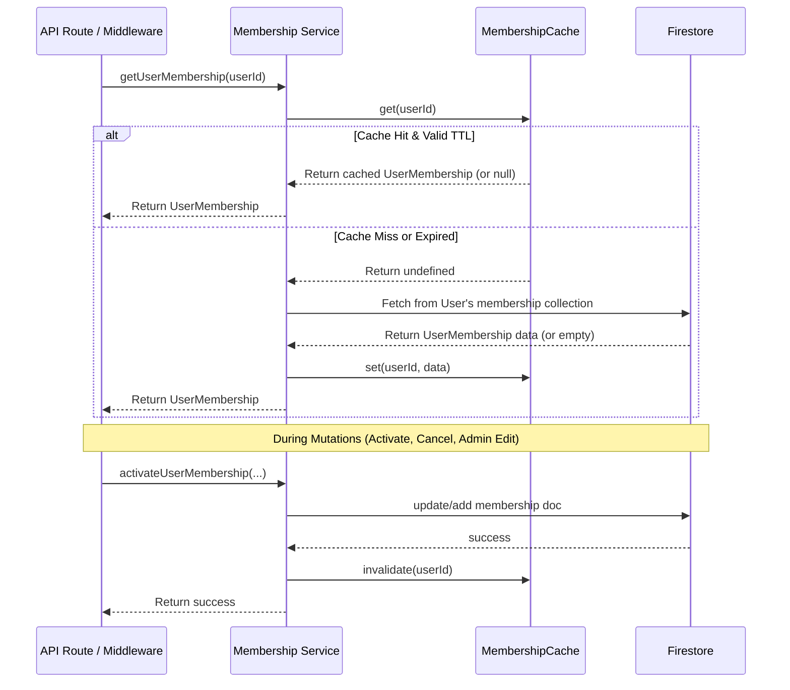

# Membership Caching System

**Location:** `lib/membership-cache.ts`
**Integration:** `service/membership.ts`

## Overview

The Membership Caching System is an in-memory utility designed to drastically reduce redundant Firestore reads for user membership data. It operates primarily within Next.js API routes and middleware, securely temporarily caching membership lookups on the server.

## The Problem

In the Next.js architecture, user authorization, premium features, and route protections frequently require verifying a user's membership status. Prior to caching, validating a user across middleware and multiple API routes during a single page load resulted in numerous duplicate Firestore calls (`getUserMembership`) for the same `userId`.

This caused:

- **High Latency:** Sequential and parallel database roundtrips slowed down server response times (specifically during middleware execution).
- **Increased Database Load:** Spikes in identical Firestore read operations.
- **Higher Costs:** Unnecessary billing for duplicate read operations on unchanged data.

## The Solution

To resolve this, we implemented an in-memory caching helper (`MembershipCache`) in `lib/membership-cache.ts`.

- **Default TTL:** 2 minutes (`120,000` ms)
- **Capacity Limit:** 2,000 entries max

The short TTL ensures that membership modifications reflect quickly across sessions and potential parallel server instances, while the capacity limit prevents memory leaks in long-running processes. The cache intelligently stores `null` values as well, ensuring that users _without_ a membership do not trigger repeated empty queries.

## Data Flow

The sequence below illustrates how `getUserMembership` interacts with the cache and Firestore, as well as how mutations trigger synchronous cache invalidation.



## Usage

The caching logic is tightly integrated into the core `service/membership.ts` functions. You do not need to manually interact with `membershipCache` in UI components or standard API routes—use the service functions provided.

### 1. Standard Fetching (Auto-Cached)

By default, fetching a user's membership will automatically query the cache.

```typescript
import { getUserMembership } from "@/service/membership";

// Will hit the cache if called recently
const membership = await getUserMembership(userId);
```

### 2. Bypassing the Cache

In critical scenarios where absolute real-time accuracy is required (e.g., checkout success callbacks, payment webhooks, or admin dashboards), you can bypass the cache.

```typescript
import { getUserMembership } from "@/service/membership";

// Forces a direct Firestore query and updates the cache with the fresh result
const membership = await getUserMembership(userId, { bypassCache: true });
```

### 3. Cache Invalidation

When modifying a user's membership (creating, editing, cancelling), the cache for that specific user is synchronously invalidated. This is already handled within the mutation functions in `service/membership.ts`.

```typescript
import membershipCache from "@/lib/membership-cache";

// Inside a mutation service function:
export const cancelUserMembership = async (
  userId: string,
  membershipId: string,
) => {
  // ... Firestore update logic ...

  // Purge the stale cache entry
  membershipCache.invalidate(userId);

  return { success: true };
};
```

## Architectural Considerations

### Single-Instance & Serverless Behavior

Because Next.js often operates in serverless environments (like Vercel or Firebase App Hosting) or multi-node container setups, in-memory caches are isolated to the specific runtime instance handling the request.

- **Stale-Read Protection:** The highly aggressive `120,000` ms (2-minute) Time-to-Live (TTL) is specifically chosen to mitigate "split-brain" stale reads. If Node A caches a membership, and Node B updates it, Node A will only serve stale data for a maximum of 2 minutes before automatically requesting fresh data from Firestore.
- **Middleware Efficiency:** Because middleware executes repeatedly for the same user across asset/page requests, the in-memory cache guarantees near 0ms lookups for the duration of the TTL on that specific instance.

### Memory & Eviction Logic

To protect the Node.js memory footprint, the cache has a hard limit of `2000` items:

1. **Lazy Evaluation:** Entries are evaluated for expiration passively upon `get()` requests.
2. **Synchronous Pruning:** When a new `set()` pushes the cache over its maximum size, it will synchronously prune all expired entries.
3. **Oldest-Key Eviction:** If pruning expired entries doesn't free up enough space, the cache defaults to evicting the oldest inserted key (pseudo-LRU) until the size constraints are satisfied.
