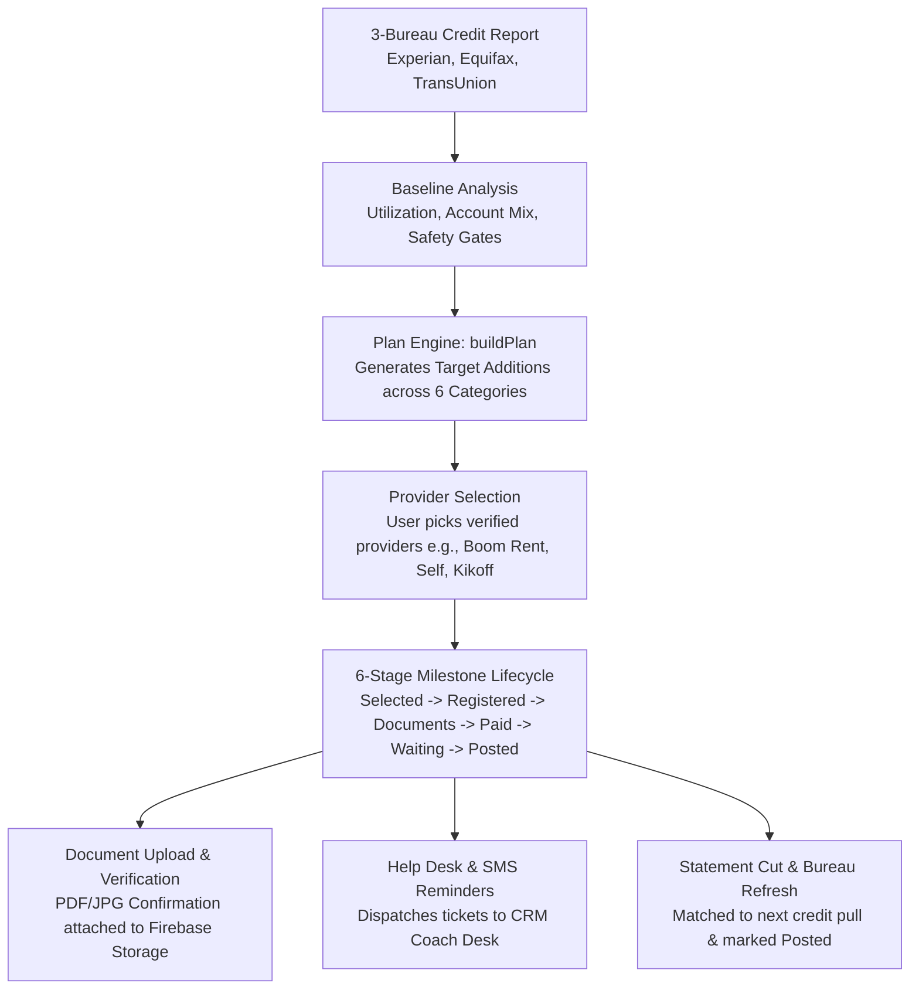

# Positive Credit Coach: Complete Lifecycle & Admin Guide

## 1. Overview & Architecture

The **Positive Credit Coach** in [`ceg-united-app/components/tradelines/PositiveCoachView.tsx`](../components/tradelines/PositiveCoachView.tsx:251) provides a client-facing credit-building engine. It ingests 3-bureau credit reports, computes personalized tradeline addition recommendations, walks clients through a 6-stage enrollment milestone workflow, and synchronizes status with the administrative CRM.



---

## 2. Complete Step-by-Step Lifecycle

### Phase 1: 3-Bureau Report Ingestion & Baseline Analysis
1. **Live Data Fetch**: [`getUserPositiveSnapshot()`](../service/positive.ts:250) fetches and normalizes data from the `crs-report-data` collection in Firestore.
2. **Key Metric Computations**:
   - **Score & Delta Gauges**: Equifax, TransUnion, and Experian score arcs displaying current score and month-over-month score change.
   - **Own-Card Utilization**: Calculated via [`utilization()`](../lib/positive/core.ts:182) to isolate primary revolving debt vs. authorized user lines.
   - **Dispute Linking**: If derogatory negative items exist, direct links route clients to the CEG Dispute section.

---

### Phase 2: Category Recommendation Engine ("Here's Your Path Forward")
The system deterministically computes target additions via [`buildPlan()`](../lib/positive/core.ts:312) across **6 distinct credit-building categories**:

| Category | Type | Recommendation Condition | Safety Preconditions |
| :--- | :--- | :--- | :--- |
| **`au`** | Authorized User Tradelines | High revolving utilization ($\ge 30\%$) or $< 2$ primary revolving cards. | Non-debt addition (no hard inquiry or direct liability). |
| **`rent`** | Rent Payment Reporting | Client pays rent (`context.rents === true`) and has 0 active rent tradelines. | Low risk (adds payment streaks without new debt). |
| **`bills`** | Utility & Phone Subscriptions | Client has eligible recurring bills (Experian Boost, eCredable). | Verified recurring service bills only. |
| **`installment`** | Primary Credit Builder Loans | Client has 0 positive installment accounts. | **Primary Safety Gate**: Score $\ge 580$, 0 negatives, inquiries $< 3$, DTI $< 40\%$. |
| **`revolving`** | Secured Revolving Lines | Client has $< 3$ revolving cards and low deposit budget ($< \$200$). | **Primary Safety Gate** must pass. |
| **`cards`** | Graduating / Primary Cards | Client has $< 3$ revolving cards and deposit budget $\ge \$200$. | **Primary Safety Gate** must pass. |

---

### Phase 3: Provider Selection (Provider Picker Modal)
1. Clicking **"Choose What Works For Me"** opens the Provider Picker Modal.
2. Clients browse verified lenders and reporting services (e.g., *Boom Rent*, *Self*, *Kikoff*, *Ava*, *Credit Strong*).
3. The system enforces maximum category quotas and verifies monthly/setup cost affordability against client budgets.
4. Saving choices triggers `action: "select"` in [`route.ts`](../app/api/user/[userId]/positive/route.ts:52), initializing an active enrollment document in Firestore.

---

### Phase 4: 6-Stage Enrollment & Milestone Workflow (The Stepper Modal)

When a client clicks **"Continue Setup"** on an enrolled account (e.g. *Boom Rent Reporting*), the 6-stage milestone tracker modal appears:

```
[1. Selected] ──> [2. Registered] ──> [3. Documents] ──> [4. Paid / Ready] ──> [5. Waiting to Post] ──> [6. Verified Posted]
```

1. **Step 1 — Selected (`selected`)**:
   - Initial candidate state. Client views verified setup instructions and clicks **"Visit Official Portal"** to apply directly with the provider.
2. **Step 2 — Registered (`registered`)**:
   - Client confirms direct registration on the provider portal. The UI requests registration confirmation documents.
3. **Step 3 — Documents Uploaded (`documents`)**:
   - Client uploads a redacted confirmation (PDF, JPG, PNG $\le$ 10MB) via [`uploadPositiveDocumentFile()`](../service/positive.ts:506). The file is stored in Firebase Storage (`user/{userId}/positive/{enrollmentId}/...`) and attached to the enrollment record.
4. **Step 4 — Paid / Ready (`paid`)**:
   - Confirms required security deposit, initial payment, or setup fee is complete.
5. **Step 5 — Waiting to Post (`waiting`)**:
   - Setup is complete. The system monitors the upcoming statement cut date and schedules automated matching against subsequent 3-bureau credit pulls.
6. **Step 6 — Verified Posted (`posted`)**:
   - The tradeline is confirmed active and reporting positive payment history on the client's credit file across connected bureaus.

---

### Phase 5: Coaching & In-App Help Desk
- **Prompt Chips & Help Inquiries**: Clients can click quick-prompt chips (e.g., *"When is the statement cut date?"*, *"How do I confirm AU addition?"*) or submit custom questions via [`requestPositiveHelp()`](../service/positive.ts:550).
- Submitting sets `helpRequested: true` and dispatches a task document to `user/{userId}/positiveEnrollments/{enrollmentId}/helpRequests/{timestamp}` for the coach desk.
- **SMS Reminders**: Clients can toggle SMS consent for TCPA-compliant statement cut date and milestone reminders.

---

### Phase 6: Post-Plan Score Projection
- [`ProjectionTableComponent()`](../components/tradelines/PositiveCoachView.tsx:2162) and [`estimatePositiveScenario()`](../service/positive.ts:597) run simulation models projecting aggregate utilization drops and estimated FICO score improvements once accounts post.

---

## 3. Where to View and Manage Status on the Admin / CRM Side

Client Positive Coach activity and enrollment statuses can be viewed in **three administrative locations**:

### 1. CEG CRM Client Profile (`PositiveAccountsCard`)
* **File Location**: [`ceg-united-crm/app/components/PositiveAccountsCard.tsx`](../../ceg-united-crm/app/components/PositiveAccountsCard.tsx:7)
* **Parent View**: [`ceg-united-crm/app/components/ClientProfile.tsx`](../../ceg-united-crm/app/components/ClientProfile.tsx:185)
* **Navigation Path**:
  1. Open the CRM application (`ceg-united-crm`).
  2. Select any client from the Client Pipeline or Review Queue.
  3. In the client profile detail pane, locate the **"Positive Account Coach (Tradelines)"** card.

#### What the Admin Sees & Can Do:
* **Metric Summary Badges**:
  * **Active in Flight**: Total enrollments in progress (`selected`, `registered`, `documents`, `paid`, `waiting`).
  * **Verified Posted**: Total enrollments confirmed active on bureau files.
  * **Help Requests**: Count highlighted in red if any step has `helpRequested === true`.
* **Enrollment Items Table**:
  * Provider Name and Category (e.g., *Boom Rent Reporting*, *Authorized User line*).
  * Credit Limit and Balance.
  * Current Stage Pill (e.g., `WAITING`, `REGISTERED`, `PAID`, `POSTED`).
  * Red **`HELP`** badge if the client submitted a coaching inquiry.
  * **"Mark Posted" Button**: For any unverified or in-progress account (`stage !== "posted"`), admins can click the **Mark Posted** button to manually verify and advance the enrollment to `POSTED` via [`markClientPositiveEnrollmentPostedAction()`](../../ceg-united-crm/app/actions/crm.ts:1508).

---

### 2. CRM Backend Action & Firestore Database Collections
* **Server Actions**:
  * [`fetchClientPositiveAccountsAction()`](../../ceg-united-crm/app/actions/crm.ts:1437): Fetches active and posted positive tradelines.
  * [`markClientPositiveEnrollmentPostedAction()`](../../ceg-united-crm/app/actions/crm.ts:1508): Directly sets enrollment stage to `posted` and records `matchedAccountId: "admin-verified"`.
* **Firestore Data Collections**:
  * `user/{brainUid}/positiveEnrollments`: Contains each enrollment record with fields:
    * `stage` (`"selected"` | `"registered"` | `"documents"` | `"paid"` | `"waiting"` | `"posted"`)
    * `documentPath` and `documentUrl` (Direct link to uploaded registration receipts)
    * `helpRequested` (`true` / `false`)
    * `nextCheckAt` (Scheduled bureau check timestamp)
    * `updatedAt` and `version`
  * `user/{brainUid}/positiveEnrollments/{enrollmentId}/helpRequests`: Subcollection containing messages submitted by the client with status `"open"`.
  * `user-tradeline`: Stores purchased primary or authorized-user tradelines.

---

### 3. In-App Knowledge Base Admin Modal
* **UI Trigger**: [`PositiveCoachView.tsx`](../components/tradelines/PositiveCoachView.tsx:537)
* **Component**: [`AdminModalComponent()`](../components/tradelines/PositiveCoachView.tsx:2265)
* **How to Access**:
  * When logged in with administrative privileges (`snapshot.canAdmin === true`), a **"Knowledge Base Admin"** button appears in the top-right header of [`PositiveCoachView.tsx`](../components/tradelines/PositiveCoachView.tsx:541).
* **Capabilities**:
  1. **Provider Library Tab**: Add, edit, or disable catalog lenders (configure names, portal URLs, credit limits, balances, reported bureaus, fees, and client-facing instructions).
  2. **Priority Rules Tab**: Configure category quota limits (`maxAdditions`), underwriting reasoning, and rule versions.

---

## 4. Key Source File Reference

| Purpose | File Path |
| :--- | :--- |
| **Client UI & Stepper Modal** | [`ceg-united-app/components/tradelines/PositiveCoachView.tsx`](../components/tradelines/PositiveCoachView.tsx:1) |
| **Recommendation Engine & State Rules** | [`ceg-united-app/lib/positive/core.ts`](../lib/positive/core.ts:1) |
| **Backend Services & Storage Handler** | [`ceg-united-app/service/positive.ts`](../service/positive.ts:1) |
| **API Endpoints (`/api/user/[userId]/positive`)** | [`ceg-united-app/app/api/user/[userId]/positive/route.ts`](../app/api/user/[userId]/positive/route.ts:1) |
| **CRM Admin Positive Accounts Card** | [`ceg-united-crm/app/components/PositiveAccountsCard.tsx`](../../ceg-united-crm/app/components/PositiveAccountsCard.tsx:1) |
| **CRM Server Actions** | [`ceg-united-crm/app/actions/crm.ts`](../../ceg-united-crm/app/actions/crm.ts:1437) |
| **Path Forward Calculation Specification** | [`ceg-united-app/docs/POSITIVE_COACH_PATH_FORWARD_CALCULATION.md`](POSITIVE_COACH_PATH_FORWARD_CALCULATION.md:1) |
