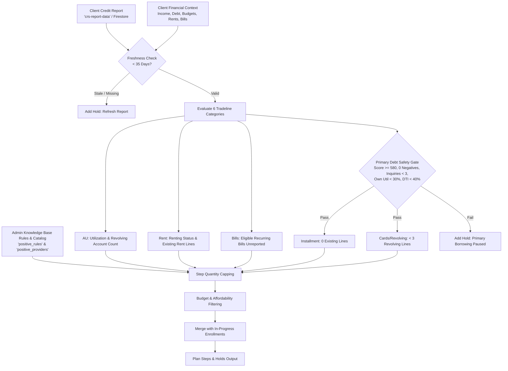

# Positive Credit Coach: "Here's Your Path Forward" Calculation Guide

## Overview

The **"Here’s Your Path Forward"** section within [`PositiveCoachView`](../../components/tradelines/PositiveCoachView.tsx:253) provides a personalized, rule-based credit-building roadmap tailored to the client's 3-bureau credit report and financial profile.

All recommendations are deterministically computed in [`buildPlan()`](../../lib/positive/core.ts:312) in [`lib/positive/core.ts`](../../lib/positive/core.ts:312). The engine analyzes report freshness, revolving utilization, active tradeline mix, primary debt safety criteria, client budget constraints, and active administrative knowledge-base rules.

---

## Architecture & Data Flow



---

## Calculation Pipeline

### 1. Preconditions & Freshness Check

Before calculating additions, [`buildPlan()`](../../lib/positive/core.ts:312) checks if the credit report is present and recent:
- If no credit report exists, the plan returns an empty step list with a hold: `"Connect a current credit report to build your plan."`.
- If the report is older than 35 days (`pulledAt > 35 days` ago) or has a future timestamp, a hold is raised: `"Refresh your report before adding accounts."`.

---

### 2. Category Recommendation Rules

The system calculates target quantities `q[category]` across 6 distinct categories:

| Category | Description | Primary Calculation Logic |
| :--- | :--- | :--- |
| **`au`** | Authorized User Tradelines | • If total revolving utilization $\ge 30\%$ and verified AU candidates exist: **1 AU tradeline**.<br/>• If simulated utilization after 1 AU is still $\ge 30\%$ and more AU candidates exist: **2 AU tradelines**.<br/>• If the user has $< 2$ primary revolving accounts, utilization $> 0\%$, and AU options exist: **1 AU tradeline**. |
| **`rent`** | Rental Reporting | • If client rents (`context.rents === true`) and has **0** reported rent tradelines on file: **1 rent tradeline**. |
| **`bills`** | Utility & Phone Subscriptions | • Calculated as: $\max(0, \text{context.eligibleBills} - \text{existing bill tradelines})$. |
| **`installment`** | Primary Installment Builders | • Gated by the **Primary Safety Gate**.<br/>• If client has **0** positive primary installment accounts: **1 installment builder**. |
| **`revolving`** | Primary Revolving Builders | • Gated by the **Primary Safety Gate**.<br/>• If client has $< 3$ revolving accounts and deposit budget $< \$200$: **1 revolving builder** (e.g. *Kikoff*). |
| **`cards`** | Secured / Graduating Credit Cards | • Gated by the **Primary Safety Gate**.<br/>• If client has $< 3$ revolving accounts and deposit budget $\ge \$200$: $\min(2, 3 - \text{existing revolving accounts})$ credit cards. |

---

### 3. Primary Borrowing Safety Gating

Categories that introduce new primary debt obligations (`installment`, `revolving`, `cards`) must satisfy strict underwriting prerequisites (`obligationsAllowed`):

1. **Credit Score**: Bureau score $\ge 580$.
2. **Derogatory Items**: `report.negativeCount === 0` (no active collections, charge-offs, or late payments).
3. **Hard Inquiries**: `report.hardInquiries6m < 3` (less than 3 inquiries in the past 6 months).
4. **Application Timing**: `context.applyingSoon === false` (not seeking immediate major loan/mortgage approval).
5. **Primary Own-Card Utilization**: Own revolving utilization $< 30\%$ (or 0 existing cards).
6. **Debt-to-Income (DTI)**: $\text{DTI} = \frac{\text{monthlyDebt}}{\text{monthlyIncome}} < 0.40$ ($< 40\%$).
7. **Budget**: Monthly budget is specified.

> **When Safety Criteria Fail**: The quantities for `installment`, `revolving`, and `cards` are set to `0`, and a cautionary hold message is placed:  
> *"New primary borrowing is paused until balances, affordability, recent applications and unresolved issues are reviewed."*

---

### 4. AU Ranking & Impact Assessment

AU recommendations are sorted and filtered through [`rankedAUs()`](../../lib/positive/core.ts:271):
- Providers must be active, verified, reporting to the active bureau, and have:
  - 100% on-time history confirmed
  - Balance-to-limit ratio $< 10\%$
  - Zero duplicate account IDs on the client's existing report
- Candidates are ranked by **highest utilization percentage point reduction**, followed by **account age / seasoning**.

---

### 5. Admin Knowledge-Base Rule Capping

Administrative rules configured in the Knowledge Base ([`snapshot.rules`](../../components/tradelines/PositiveCoachView.tsx:424)) enforce category limits:
```ts
q[category] = Math.min(q[category], Math.max(0, rule.maxAdditions));
```
*Note: Admin rules can restrict quantities or update guidance copy, but cannot bypass core underwriting safety checks.*

---

### 6. Budget & Affordability Filtering

For fee-based categories (`installment`, `revolving`, `cards`):
1. Eligible catalog providers are sorted by lowest monthly fee (`p.monthlyCost`).
2. Providers are approved only if `monthlyCost <= remainingMonthlyBudget` and `setupCost <= remainingDepositBudget`.
3. Costs are deducted sequentially from remaining budgets.

---

### 7. Active Enrollment Merging

To preserve user progress across sessions:
```ts
const started = snapshot.enrollments.filter(
  (e) => e.category === category && e.stage !== "posted"
).length;

const quantity = Math.max(q[category], started);
```
If `quantity > 0`, a step is rendered with:
- Step number and category badge
- Target addition count and category label
- Personalized rationale and admin instructions
- Active enrollment cards with milestone trackers
- Provider selection modal trigger (`"Review My Choices"` / `"Choose What Works For Me"`)

---

## File References

| File | Purpose |
| :--- | :--- |
| [`ceg-united-app/lib/positive/core.ts`](../../lib/positive/core.ts:312) | Core algorithm implementation ([`buildPlan`](../../lib/positive/core.ts:312), [`rankedAUs`](../../lib/positive/core.ts:271), [`auImpact`](../../lib/positive/core.ts:230), [`utilization`](../../lib/positive/core.ts:182)). |
| [`ceg-united-app/components/tradelines/PositiveCoachView.tsx`](../../components/tradelines/PositiveCoachView.tsx:834) | UI component rendering the "Here's Your Path Forward" section, step accordions, and action handlers. |
| [`ceg-united-app/service/positive.ts`](../../service/positive.ts:250) | Backend data ingestion, CRS report normalization, and Firestore state snapshot generation. |
