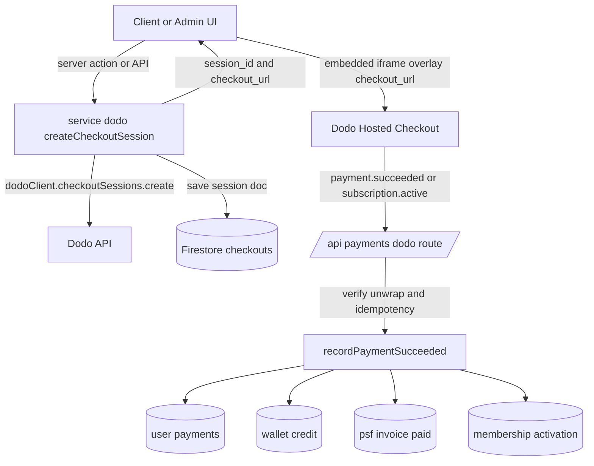

# Whop → Dodo Payments Migration Plan

> Companion to [`WHOP_INVENTORY.md`](./WHOP_INVENTORY.md). This document maps
> every Whop asset to its Dodo Payments equivalent and provides an ordered,
> actionable implementation checklist.

---

## 0. Locked Decisions

The following choices are confirmed and drive the rest of this plan:

| #   | Decision           | Choice                                                                                                                                                                                                                                                                                                                                         |
| --- | ------------------ | ---------------------------------------------------------------------------------------------------------------------------------------------------------------------------------------------------------------------------------------------------------------------------------------------------------------------------------------------- |
| 1   | Checkout UX        | **Keep the embedded experience.** Render Dodo's hosted checkout inside the app via the returned `checkout_url` (iframe/overlay), replacing `WhopCheckoutEmbed` one-for-one. No full-page redirect.                                                                                                                                             |
| 2   | Membership pricing | **Keep dynamic pricing.** Memberships become **on-demand subscriptions** (`subscription_data.on_demand.mandate_only`), with the actual price supplied at charge time from `getFeeSettings()` via [`client.subscriptions.charge`](https://docs.dodopayments.com). Variable one-time amounts use **BYOP** products with `product_cart[].amount`. |

### 0.1 Embedded checkout approach

`client.checkoutSessions.create` returns `{ session_id, checkout_url }`. To keep
an in-page embed like the current `WhopCheckoutEmbed`:

- Create the session server-side (as today), persist it, and return
  `checkout_url` to the client.
- Render `checkout_url` inside an embedded container (iframe/overlay) in the
  new `DodoCheckoutView` component — a drop-in replacement for
  `WhopCheckoutEmbed sessionId={...}`.
- Use `return_url` for the post-payment landing, but treat the **webhook** as
  the source of truth (never grant access on redirect).
- Optionally set `customization.theme` / `theme_config` on session create to
  match the app styling, and `allowed_payment_method_types` to reproduce the
  card/apple_pay/google_pay restriction (always include `credit`/`debit`).

> Confirm whether Dodo ships an official React embed/overlay package for your
> version; if so prefer it, otherwise embed `checkout_url` directly. Either way
> the server-side session creation is identical.

### 0.2 Dynamic membership pricing (on-demand subscriptions)

Because Dodo subscription price normally lives on the product, dynamic
membership prices are handled with **on-demand subscriptions**:

1. Create a subscription checkout session with
   `subscription_data.on_demand = { mandate_only: true, product_price, product_currency: "usd" }`.
   `mandate_only: true` sets up the payment mandate without a fixed recurring
   price; `product_price` seeds the first charge amount.
2. On `subscription.active`, store the `subscription_id`.
3. For each billing cycle (or immediate charge), call
   `client.subscriptions.charge(subscription_id, { product_price })` with the
   amount derived from `getFeeSettings()` at that moment. `product_price` is in
   the smallest currency unit (cents).
4. Recurring cadence is driven by your own scheduler (e.g., a scheduled Cloud
   Function) invoking `subscriptions.charge`, since price is not fixed on the
   product.

This preserves the current behavior where `feeSettings.tierStarterPrice` etc.
determine the amount at runtime, and where the `credit_module_pro` addon is
added to the amount.

---

## 1. Key Conceptual Differences

| Concept               | Whop (current)                                                         | Dodo Payments (target)                                                                                          |
| --------------------- | ---------------------------------------------------------------------- | --------------------------------------------------------------------------------------------------------------- |
| Client SDK            | `@whop/sdk` (`new Whop({ apiKey, baseURL, webhookKey })`)              | `dodopayments` (`new DodoPayments({ bearerToken, environment })`)                                               |
| Env selection         | `WHOP_BASE_URL`                                                        | `environment: 'test_mode' \| 'live_mode'` (or `baseURL`)                                                        |
| Checkout creation     | `whopSdk.checkoutConfigurations.create({ plan, metadata })`            | `client.checkoutSessions.create({ product_cart, customer, metadata, return_url, ... })`                         |
| Checkout identifier   | `checkoutConfig.id` + `purchase_url`                                   | `session.session_id` + `checkout_url`                                                                           |
| Variable/custom price | `plan.initial_price` on a hidden plan                                  | `product_cart[].amount` (Pay-What-You-Want / BYOP product)                                                      |
| Recurring             | `plan_type: "renewal"`, `renewal_price`, `billing_period`              | Subscription **product** + `subscription_data`; price defined on product                                        |
| One-time              | `plan_type: "one_time"`, `initial_price`                               | One-time **product** in `product_cart`                                                                          |
| Embedded checkout     | `WhopCheckoutEmbed sessionId={checkoutId}` from `@whop/checkout/react` | Overlay/embedded via `checkout_url` (redirect) or Dodo React overlay; **simplest = redirect to `checkout_url`** |
| Webhook verify        | `whopSdk.webhooks.unwrap(body, { headers })`                           | `client.webhooks.unwrap(rawBody, { headers })` (Standard Webhooks)                                              |
| Success event         | `payment.succeeded` (`Payment`)                                        | `payment.succeeded` (one-time), `subscription.active` (subscriptions)                                           |
| Customer identity     | resolved by email post-payment                                         | `customer: { email }` on session; Dodo returns `customer_id`                                                    |
| Merchant model        | Whop hosts                                                             | Dodo is **Merchant of Record** (handles tax/disputes)                                                           |

### Critical architectural shift: products replace inline plans

Whop lets you invent a price inline (`initial_price` on a hidden plan). Dodo
requires a **product** to exist. Two options for variable amounts (tradelines,
wallet top-up, PSF invoices, CRS fees):

- **Option A (recommended): BYOP / Pay-What-You-Want products.** Create one
  reusable product per variable-price use case and pass `product_cart[].amount`
  at session creation.
- **Option B: pre-create products** for each fixed tier (audit/intelligence/
  accelerator/membership tiers) and reference their `product_id`.

This plan assumes a **hybrid**: fixed-price tiers become real Dodo products;
variable amounts use BYOP products with `amount` overrides.

---

## 2. Product & Price Mapping

| Whop env var (product)                | Purpose                                 | Dodo product to create                    | Type                  |
| ------------------------------------- | --------------------------------------- | ----------------------------------------- | --------------------- |
| `WHOP_PRODUCT_ID`                     | Audit/Intelligence/Accelerator one-time | 3 one-time products (or 1 BYOP)           | one-time              |
| `WHOP_TRADELINE_PRODUCT_ID`           | Tradeline purchase (cart total)         | 1 BYOP product                            | one-time (amount)     |
| `WHOP_WALLET_PRODUCT_ID`              | Wallet top-up                           | 1 BYOP product                            | one-time (amount)     |
| `WHOP_PSF_PRODUCT_ID`                 | PSF success-fee invoice                 | 1 BYOP product                            | one-time (amount)     |
| `WHOP_GENERATE_CRS_REPORT_PRODUCT_ID` | CRS report fee                          | 1 BYOP product                            | one-time (amount)     |
| `WHOP_PRICING_PLAN_STARTER_ID`        | Membership starter                      | 1 on-demand subscription product          | recurring (on-demand) |
| `WHOP_PRICING_PLAN_PRO_ID`            | Membership pro                          | 1 on-demand subscription product          | recurring (on-demand) |
| `WHOP_PRICING_PLAN_EXECUTIVE_ID`      | Membership executive                    | 1 on-demand subscription product          | recurring (on-demand) |
| `WHOP_CREDIT_REPAIR_PRODUCT_ID`       | credit_module_pro addon                 | 1 on-demand subscription product or addon | recurring (on-demand) |

> **Decision locked (see §0.2):** Membership products are created as **on-demand
> subscriptions** (`mandate_only`). The runtime price from `getFeeSettings()` is
> supplied at session creation (`subscription_data.on_demand.product_price`) and
> on each subsequent charge via `client.subscriptions.charge`. A scheduler drives
> recurring charges since price is not fixed on the product.

---

## 3. New Environment Variables

Replace the Whop block in [`example.env`](../../example.env:40):

```bash
# Dodo Payments
DODO_PAYMENTS_API_KEY=            # dodo_test_... / dodo_live_...
DODO_PAYMENTS_WEBHOOK_KEY=        # webhook signing secret
DODO_PAYMENTS_ENVIRONMENT=        # test_mode | live_mode

# Product IDs (created in Dodo dashboard)
DODO_PRODUCT_AUDIT_ID=
DODO_PRODUCT_INTELLIGENCE_ID=
DODO_PRODUCT_ACCELERATOR_ID=
DODO_PRODUCT_TRADELINE_ID=        # BYOP
DODO_PRODUCT_WALLET_ID=           # BYOP
DODO_PRODUCT_PSF_ID=              # BYOP
DODO_PRODUCT_CRS_REPORT_ID=       # BYOP
DODO_PRODUCT_MEMBERSHIP_STARTER_ID=
DODO_PRODUCT_MEMBERSHIP_PRO_ID=
DODO_PRODUCT_MEMBERSHIP_EXECUTIVE_ID=
DODO_PRODUCT_CREDIT_MODULE_PRO_ID=
```

Retain the down-payment amount vars (they drive `amount` values, not Whop-specific).

---

## 4. File-by-File Migration Map

### 4.1 SDK layer

| File                                                             | Action                                                                                                                                      |
| ---------------------------------------------------------------- | ------------------------------------------------------------------------------------------------------------------------------------------- |
| [`lib/whop-sdk.ts`](../../lib/whop-sdk.ts:1) → `lib/dodo-sdk.ts` | Replace with `new DodoPayments({ bearerToken: DODO_PAYMENTS_API_KEY, environment })`. Export `dodoClient`. Keep a dummy fallback for tests. |

### 4.2 Service layer — [`service/whop/index.ts`](../../service/whop/index.ts:1) → `service/dodo/index.ts`

Each `create*CheckoutConfig` becomes a `checkoutSessions.create` call. Common
transformation:

```typescript
// BEFORE (Whop)
const checkoutConfig = await whopSdk.checkoutConfigurations.create({
  plan: {
    company_id,
    currency: "usd",
    initial_price: amount,
    plan_type: "one_time",
    product_id,
    visibility: "hidden",
  },
  metadata: { userId, email, name },
});
return { checkoutId: checkoutConfig.id, url: checkoutConfig.purchase_url };

// AFTER (Dodo)
const session = await dodoClient.checkoutSessions.create({
  product_cart: [{ product_id: DODO_PRODUCT_X_ID, quantity: 1, amount }], // amount only for BYOP
  customer: { email: user.email, name: `${user.firstName} ${user.lastName}` },
  metadata: { userId, paymentKey },
  return_url: `${APP_URL}/checkout/success`,
});
return { checkoutId: session.session_id, url: session.checkout_url };
```

| Function                                                        | Dodo mapping notes                                                                                                                                                                                                                                                                                                                |
| --------------------------------------------------------------- | --------------------------------------------------------------------------------------------------------------------------------------------------------------------------------------------------------------------------------------------------------------------------------------------------------------------------------- |
| `createWhopCheckoutConfig`                                      | one-time product(s); `amount` for tradeline BYOP. Keep the existing-checkout reuse cache logic.                                                                                                                                                                                                                                   |
| `createMembershipCheckoutConfig`                                | **on-demand subscription** per tier: `subscription_data.on_demand = { mandate_only: true, product_price: amountInCents, product_currency: "usd" }` where `amount` still derives from `getFeeSettings()` + addon. Store `subscription_id` on `subscription.active`. Recurring charges via `subscriptions.charge` from a scheduler. |
| `createAddonCheckoutConfig`                                     | subscription/addon product `DODO_PRODUCT_CREDIT_MODULE_PRO_ID`.                                                                                                                                                                                                                                                                   |
| `createCRSReportCheckoutConfig`                                 | BYOP `amount = feeAmount`; use `allowed_payment_method_types` for card/apple/google.                                                                                                                                                                                                                                              |
| `createWalletCheckoutConfig`                                    | BYOP `amount`; metadata `paymentKey: "WalletTopUp"`.                                                                                                                                                                                                                                                                              |
| `createPsfInvoiceCheckoutConfig`                                | BYOP `amount = feeInCents` (verify Dodo amount units — likely smallest currency unit). Metadata `paymentKey: "PSF_INVOICE"`, `invoiceId`.                                                                                                                                                                                         |
| `recordPaymentSucceeded`                                        | Split by event: `payment.succeeded` for one-time (wallet/PSF/tradeline/CRS), `subscription.active` for memberships. Read `metadata.userId` directly instead of email lookup (more reliable). Preserve wallet-credit + PSF-paid side effects with idempotency.                                                                     |
| `getWhopPayments` / `mapWhopPaymentToUser` / `unmapWhopPayment` | Same Firestore logic; only the stored payment shape changes (Dodo `Payment` fields).                                                                                                                                                                                                                                              |
| `getWhopCheckoutDetailByCheckoutId`                             | Same; key stored doc by `session_id`.                                                                                                                                                                                                                                                                                             |
| `sendPaymentLink`                                               | Unchanged logic; still writes request doc.                                                                                                                                                                                                                                                                                        |

> **Payment-method restriction:** Whop's `payment_method_configuration` maps to
> Dodo's `allowed_payment_method_types` (always include `credit`/`debit` fallback).

> **Amount units:** Whop comment says "amount in dollars" in some places and
> "cents" in others. Confirm Dodo's unit (Dodo uses the smallest currency unit /
> integer). Audit every `amount`/`initial_price` during implementation.

### 4.3 Webhook — [`app/api/payments/whop/route.ts`](../../app/api/payments/whop/route.ts:1)

Rename route to `app/api/payments/dodo/route.ts` (or keep path, swap internals).

```typescript
const rawBody = await request.text();
const event = dodoClient.webhooks.unwrap(rawBody, {
  headers: {
    "webhook-id": request.headers.get("webhook-id")!,
    "webhook-signature": request.headers.get("webhook-signature")!,
    "webhook-timestamp": request.headers.get("webhook-timestamp")!,
  },
});
if (event.type === "payment.succeeded") {
  /* one-time */
}
if (event.type === "subscription.active") {
  /* membership */
}
```

- Add **idempotency** keyed on `webhook-id` (Whop version lacked this).
- Update [`proxy.ts`](../../proxy.ts:28) public path if renamed.

### 4.4 API routes

| Route                                                                                                                                  | Action                                                   |
| -------------------------------------------------------------------------------------------------------------------------------------- | -------------------------------------------------------- |
| [`app/api/payments/whop/list/route.ts`](../../app/api/payments/whop/list/route.ts:1)                                                   | rename → `dodo`; call unchanged service                  |
| [`app/api/payments/whop/map/route.ts`](../../app/api/payments/whop/map/route.ts:1)                                                     | rename → `dodo`                                          |
| [`app/api/payments/whop/unmap/route.ts`](../../app/api/payments/whop/unmap/route.ts:1)                                                 | rename → `dodo`                                          |
| [`app/api/whop/payments/route.ts`](../../app/api/whop/payments/route.ts:1)                                                             | rename → `dodo` (duplicate endpoint — consider removing) |
| [`app/api/whop/checkout/[checkoutId]/route.ts`](../../app/api/whop/checkout/[checkoutId]/route.ts:1)                                   | rename → `dodo`; lookup by `session_id`                  |
| [`app/api/user/[userId]/whop/route.ts`](../../app/api/user/[userId]/whop/route.ts:1)                                                   | rename → `dodo`; call renamed service                    |
| [`app/api/user/[userId]/tradelines/checkout/route.ts`](../../app/api/user/[userId]/tradelines/checkout/route.ts:1)                     | swap to Dodo BYOP `amount`                               |
| [`app/api/user/[userId]/tradelines/purchase/route.ts`](../../app/api/user/[userId]/tradelines/purchase/route.ts:1)                     | rename `whop_*` fields → `dodo_*` (or generic)           |
| [`app/api/user/[userId]/crs/purchase/route.ts`](../../app/api/user/[userId]/crs/purchase/route.ts:1)                                   | update comment; relies on webhook sync                   |
| [`app/api/user/[userId]/psf-invoices/[invoiceId]/sign/route.ts`](../../app/api/user/[userId]/psf-invoices/[invoiceId]/sign/route.ts:1) | swap service call; rename stored `whopCheckoutId/Url`    |
| [`app/api/user/[userId]/psf-invoices/[invoiceId]/send/route.ts`](../../app/api/user/[userId]/psf-invoices/[invoiceId]/send/route.ts:1) | same                                                     |

> **Optional:** Consider adopting `@dodopayments/nextjs` adapter to replace
> hand-rolled checkout/portal/webhook routes. Decide in §8.

### 4.5 Hooks

| File                                                                                                    | Action                                                                        |
| ------------------------------------------------------------------------------------------------------- | ----------------------------------------------------------------------------- |
| [`hooks/whop.ts`](../../hooks/whop.ts:1) → `hooks/dodo.ts`                                              | rename `useWhopCheckoutDetails` → `useDodoCheckoutDetails`; new endpoint path |
| [`hooks/admin/payments/whop.ts`](../../hooks/admin/payments/whop.ts:1) → `hooks/admin/payments/dodo.ts` | rename hooks + endpoints                                                      |
| [`constant/react-query-keys.ts`](../../constant/react-query-keys.ts:32)                                 | rename `GET_WHOP_*` → `GET_DODO_*`                                            |
| [`hooks/psf-invoices.ts`](../../hooks/psf-invoices.ts:1)                                                | update comments only                                                          |

### 4.6 Components & pages

| File                                                                                                                                                              | Action                                                                                                                                                                                                                                            |
| ----------------------------------------------------------------------------------------------------------------------------------------------------------------- | ------------------------------------------------------------------------------------------------------------------------------------------------------------------------------------------------------------------------------------------------- |
| [`components/funding/WhopCheckoutView.tsx`](../../components/funding/WhopCheckoutView.tsx:1) → `DodoCheckoutView.tsx`                                             | Replace `WhopCheckoutEmbed` with an **embedded** Dodo checkout (render `checkout_url` in an iframe/overlay). Preserve order-summary UI + Denefits `returnUrl` logic. Keep the `onComplete` callback semantics for the post-payment client action. |
| [`app/(public)/checkout/[checkoutId]/page.tsx`](<../../app/(public)/checkout/[checkoutId]/page.tsx:1>)                                                            | use renamed view/service                                                                                                                                                                                                                          |
| [`app/(client)/client/payments/whop/[checkoutId]/page.tsx`](<../../app/(client)/client/payments/whop/[checkoutId]/page.tsx:1>)                                    | move to `.../payments/dodo/[checkoutId]`; renamed hook                                                                                                                                                                                            |
| [`app/(client)/client/wallet/page.tsx`](<../../app/(client)/client/wallet/page.tsx:40>)                                                                           | replace embed with embedded Dodo checkout; update "powered by Whop" copy                                                                                                                                                                          |
| [`app/(client)/client/my-business/_components/BusinessDetailView.tsx`](<../../app/(client)/client/my-business/_components/BusinessDetailView.tsx:52>)             | replace embed with embedded Dodo checkout; renamed service calls (membership = on-demand subscription)                                                                                                                                            |
| [`app/(client)/client/my-business/_components/tabs/FundabilityAuditTab.tsx`](<../../app/(client)/client/my-business/_components/tabs/FundabilityAuditTab.tsx:17>) | renamed service call                                                                                                                                                                                                                              |
| [`app/(admin)/admin/payments/page.tsx`](<../../app/(admin)/admin/payments/page.tsx:1>)                                                                            | rename tab label/value `whop` → `dodo`                                                                                                                                                                                                            |
| [`app/(admin)/admin/payments/whop/*`](<../../app/(admin)/admin/payments/whop/list.tsx:1>)                                                                         | move dir → `dodo/`; rename components; `WhopPayment` → `DodoPayment`                                                                                                                                                                              |

> **Embed decision (locked, §0.1):** Keep the in-page embedded experience.
> Render the session `checkout_url` inside an iframe/overlay via the new
> `DodoCheckoutView`, replacing every `WhopCheckoutEmbed` usage one-for-one.
> Prefer an official Dodo React embed package if available for your version;
> otherwise embed `checkout_url` directly. Server-side session creation is
> identical either way.

### 4.7 Schemas & types

| File                                                      | Action                                                                                                                                    |
| --------------------------------------------------------- | ----------------------------------------------------------------------------------------------------------------------------------------- |
| [`schema/payments.ts`](../../schema/payments.ts:31)       | Replace `Payment` from `@whop/sdk/resources.js` with Dodo's `Payment` type; rename `WhopPayment` → `DodoPayment`. Keep `PaymentPlanEnum`. |
| [`schema/psf-invoice.ts`](../../schema/psf-invoice.ts:53) | rename `whopCheckoutId/whopCheckoutUrl` → `dodoCheckoutId/dodoCheckoutUrl` (or generic `checkoutId/checkoutUrl`)                          |

### 4.8 Constants

| File                                                                  | Action                                                                                                                                                                                                |
| --------------------------------------------------------------------- | ----------------------------------------------------------------------------------------------------------------------------------------------------------------------------------------------------- |
| [`constant/collection-name.ts`](../../constant/collection-name.ts:11) | Decide: keep `whop-*` collection names (avoid data migration) or rename to `dodo-*`/generic (requires data migration). Recommendation: **keep names, add comment**, or rename to neutral `payment-*`. |
| [`constant/payment.ts`](../../constant/payment.ts:14)                 | rename `whopKey` → `paymentKey`/`dodoKey` on `PricingPlan`                                                                                                                                            |

### 4.9 Config & dependencies

| File                                        | Action                                                                                                  |
| ------------------------------------------- | ------------------------------------------------------------------------------------------------------- |
| [`package.json`](../../package.json:79)     | remove `@whop/checkout`, `@whop/sdk`; add `dodopayments` (+ optional `@dodopayments/nextjs`)            |
| [`next.config.ts`](../../next.config.ts:60) | CSP `frame-src`: replace `https://whop.com` with Dodo checkout domain(s) (`https://*.dodopayments.com`) |
| [`proxy.ts`](../../proxy.ts:28)             | update public webhook/checkout paths                                                                    |

### 4.10 Tests

Rewrite/rename all Whop tests to Dodo equivalents, mocking `dodoClient`:

- [`__tests__/service/whop/*`](../../__tests__/service/whop/index.test.ts:1) → `__tests__/service/dodo/*`
- [`__tests__/hooks/admin/payments-whop.test.tsx`](../../__tests__/hooks/admin/payments-whop.test.tsx:1)
- [`__tests__/api/user/psf-invoices/send.test.ts`](../../__tests__/api/user/psf-invoices/send.test.ts:1)

---

## 5. Data Migration Considerations

| Firestore collection    | Migration decision                                                                                                                                                                                                                            |
| ----------------------- | --------------------------------------------------------------------------------------------------------------------------------------------------------------------------------------------------------------------------------------------- |
| `whop-checkouts`        | New docs use Dodo `session_id`. Old docs remain readable. Keep collection name or rename.                                                                                                                                                     |
| `user-whop-payments`    | Stored payment shape changes (Dodo `Payment`). Reads must tolerate both old (Whop) and new (Dodo) shapes during transition. Admin list columns (`total`, `product.title`, `user.email`, `status`, `created_at`) must map to Dodo field names. |
| `psf-invoices`          | Field rename `whopCheckoutId/Url` → new names; keep reading old fields for in-flight invoices.                                                                                                                                                |
| `whop-payment-requests` | No shape change.                                                                                                                                                                                                                              |

**Admin list column risk:** [`app/(admin)/admin/payments/whop/list.tsx`](<../../app/(admin)/admin/payments/whop/list.tsx:41>)
reads `created_at`, `user.email`, `total`, `status`, `product.title`. Confirm the
equivalent Dodo `Payment` fields (e.g., `total_amount`, `customer.email`,
`created_at`, `status`, product info) and adjust accessors.

---

## 6. Migration Flow (target architecture)



---

## 7. Ordered Implementation Checklist

**Phase 1 — Foundation**

- [ ] Create Dodo account, products, and BYOP products; collect product IDs
- [ ] Add Dodo env vars; install `dodopayments`; remove `@whop/*`
- [ ] Create `lib/dodo-sdk.ts`

**Phase 2 — Service layer**

- [ ] Port all one-time `create*CheckoutConfig` → `checkoutSessions.create` (BYOP `amount` for variable prices)
- [ ] Port `createMembershipCheckoutConfig` → on-demand subscription (`subscription_data.on_demand.mandate_only`, `product_price` from `getFeeSettings()`)
- [ ] Add `chargeMembership` helper wrapping `subscriptions.charge` + scheduler for recurring cycles
- [ ] Port `recordPaymentSucceeded` (split one-time vs subscription, idempotency, metadata.userId)
- [ ] Port list/map/unmap/detail helpers

**Phase 3 — Webhook & APIs**

- [ ] Rewrite webhook route with `webhooks.unwrap` + idempotency
- [ ] Update `proxy.ts` and CSP
- [ ] Update all API routes (Whop-namespaced + indirect consumers)

**Phase 4 — Frontend**

- [ ] Build embedded `DodoCheckoutView` (iframe/overlay of `checkout_url`) replacing `WhopCheckoutEmbed`
- [ ] Update client pages (wallet, business, checkout) to use the embedded view
- [ ] Update admin payments UI + column accessors
- [ ] Rename hooks + react-query keys

**Phase 5 — Schema/constants/types**

- [ ] Update `schema/payments.ts`, `schema/psf-invoice.ts`
- [ ] Update `constant/payment.ts`, `constant/collection-name.ts` (decision-dependent)

**Phase 6 — Tests & verification**

- [ ] Rewrite all tests against `dodoClient`
- [ ] Test-mode end-to-end for each flow (audit/intelligence, tradeline, wallet, PSF, CRS, membership, addon)
- [ ] Local webhook delivery test (`dodo wh trigger` / tunnel)
- [ ] Verify wallet credit + PSF paid + membership activation side effects
- [ ] Live-mode smoke test and go-live

---

## 8. Open Questions

### Resolved

1. ✅ **Embedded vs redirect checkout** → **Embedded** (keep in-page experience;
   render `checkout_url` in iframe/overlay). See §0.1.
2. ✅ **Dynamic membership pricing** → **Keep dynamic** via on-demand
   subscriptions + `subscriptions.charge`. See §0.2.

### Still open (need user input)

3. **Collection naming.** Keep `whop-*` Firestore collection names (no data
   migration) or rename to neutral `payment-*`/`dodo-*` (needs migration)?
4. **Next.js adapter.** Adopt `@dodopayments/nextjs` for checkout/portal/webhook
   handlers, or keep hand-rolled routes for minimal churn?
5. **Cutover strategy.** Hard cutover, or run Whop + Dodo in parallel behind a
   feature flag during transition?
6. **Amount units.** Confirm the intended currency unit so we audit every
   `amount` correctly (Whop code is inconsistent: some "dollars", some "cents").
   Note: Dodo uses the **smallest currency unit** (cents) for `amount` and
   `product_price`.
7. **Recurring charge scheduler.** On-demand subscriptions require your own
   scheduler to trigger `subscriptions.charge` each cycle. Confirm the mechanism
   (e.g., a scheduled Firebase Function) and cadence source.

---

## 9. Skills to Load During Implementation

| Task                                        | Skill                                              |
| ------------------------------------------- | -------------------------------------------------- |
| Hosted/overlay checkout                     | `checkout-integration`                             |
| Subscription lifecycle (memberships/addons) | `subscription-integration`                         |
| Webhook route + verification + idempotency  | `webhook-integration`                              |
| Next.js route handlers                      | `framework-adapters`                               |
| Wallet/prepaid balance (top-ups)            | `credit-based-billing` (evaluate vs custom wallet) |
| Customer portal (manage subscription)       | `customer-management`                              |
| Test mode + go-live                         | `testing-and-go-live`                              |
