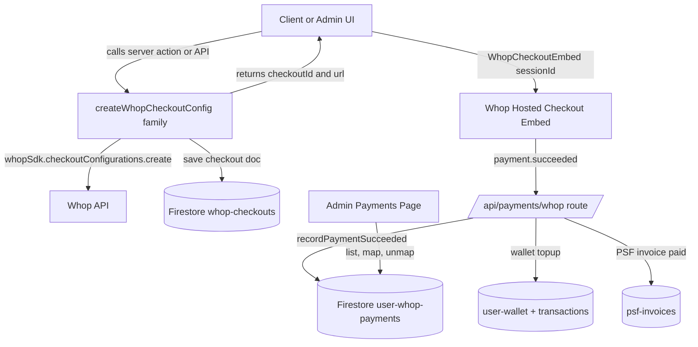

# Whop Payments — Complete Inventory

> Reference documentation of **every** Whop-related asset in the codebase.
> Prepared as the foundation for migrating from **Whop** to **Dodo Payments**.

This document catalogs all services, hooks, API routes, webhooks, components,
schemas, constants, environment variables, and dependencies that touch the Whop
payment integration. Each entry lists its responsibility and its Whop-specific
touchpoints so the migration team knows exactly what must change.

---

## 1. High-Level Architecture



**Flow summary**

1. A checkout configuration is created server-side via the Whop SDK; the
   returned `checkoutId` and `purchase_url` are persisted to the
   `whop-checkouts` Firestore collection.
2. The client renders the `WhopCheckoutEmbed` React component using that
   `checkoutId` as the `sessionId`.
3. On payment, Whop sends a `payment.succeeded` webhook to
   [`app/api/payments/whop/route.ts`](../../app/api/payments/whop/route.ts:1).
4. `recordPaymentSucceeded` records the payment, and applies side-effects for
   wallet top-ups and PSF invoices.
5. Admins reconcile unmatched payments through the admin payments UI.

---

## 2. SDK & Library Layer

| File                                         | Purpose                                    | Whop touchpoints                                                                                                        |
| -------------------------------------------- | ------------------------------------------ | ----------------------------------------------------------------------------------------------------------------------- |
| [`lib/whop-sdk.ts`](../../lib/whop-sdk.ts:1) | Instantiates the Whop SDK client singleton | `import Whop from "@whop/sdk"`, `WHOP_API_KEY`, `WHOP_BASE_URL`, `WHOP_WEBHOOK_SECRET` (base64-encoded as `webhookKey`) |

Notes:

- Default base URL is `https://api.whop.com/api/v1`.
- The exported `whopSdk` is used by both checkout creation and webhook
  verification (`whopSdk.webhooks.unwrap`).

---

## 3. Service Layer

### 3.1 `service/whop/index.ts`

Primary Whop service ([`service/whop/index.ts`](../../service/whop/index.ts:1)). Marked `"use server"`.

**Module-level env constants:** `WHOP_COMPANY_ID`, `WHOP_PRODUCT_ID`,
`WHOP_TRADELINE_PRODUCT_ID`, `WHOP_GENERATE_CRS_REPORT_PRODUCT_ID`,
`WHOP_PRICING_PLAN_STARTER_ID`, `WHOP_PRICING_PLAN_PRO_ID`,
`WHOP_PRICING_PLAN_EXECUTIVE_ID`, `WHOP_CREDIT_REPAIR_PRODUCT_ID`,
`NEXT_PUBLIC_WHOP_FULL_PAYMENT_AMOUNT`, plus the audit/intelligence/accelerator
full and down-payment amount vars.

| Exported function                   | Line                                   | Responsibility                                                                                                  | Whop specifics                                                                                                         |
| ----------------------------------- | -------------------------------------- | --------------------------------------------------------------------------------------------------------------- | ---------------------------------------------------------------------------------------------------------------------- |
| `createWhopCheckoutConfig`          | [75](../../service/whop/index.ts:75)   | One-time checkout for audit/intelligence/accelerator/tradeline plans; reuses existing checkout unless tradeline | `whopSdk.checkoutConfigurations.create`, `plan_type: "one_time"`, `visibility: "hidden"`, metadata `userId/email/name` |
| `createMembershipCheckoutConfig`    | [215](../../service/whop/index.ts:215) | Recurring membership checkout (starter/pro/executive tiers + credit_module_pro addon)                           | `plan_type: "renewal"`, `renewal_price`, `billing_period: 30`                                                          |
| `createAddonCheckoutConfig`         | [336](../../service/whop/index.ts:336) | Standalone `credit_module_pro` addon subscription                                                               | `plan_type: "renewal"`, uses `WHOP_CREDIT_REPAIR_PRODUCT_ID`                                                           |
| `createCRSReportCheckoutConfig`     | [425](../../service/whop/index.ts:425) | One-time credit report fee checkout (personal/business)                                                         | `plan_type: "one_time"`, `payment_method_configuration` restricting methods                                            |
| `createWalletCheckoutConfig`        | [509](../../service/whop/index.ts:509) | One-time wallet top-up checkout                                                                                 | `plan_type: "one_time"`, metadata `paymentKey: "WalletTopUp"`, `WHOP_WALLET_PRODUCT_ID`                                |
| `createPsfInvoiceCheckoutConfig`    | [588](../../service/whop/index.ts:588) | One-time PSF (Performance Success Fee) invoice checkout                                                         | `WHOP_PSF_PRODUCT_ID` (falls back to wallet product), metadata `paymentKey: "PSF_INVOICE"`                             |
| `recordPaymentSucceeded`            | [684](../../service/whop/index.ts:684) | Webhook handler core: resolves user by email, records payment, credits wallet top-ups, marks PSF invoices paid  | Consumes `Payment` type from `@whop/sdk/resources.js`; reads `checkout_configuration_id`, `product_id`                 |
| `getWhopPayments`                   | [853](../../service/whop/index.ts:853) | Fetches all payments from `user-whop-payments`, enriches with mapped user                                       | Reads `created_at`, orders desc                                                                                        |
| `mapWhopPaymentToUser`              | [892](../../service/whop/index.ts:892) | Admin: link a payment doc to a user                                                                             | Updates `user-whop-payments` doc                                                                                       |
| `unmapWhopPayment`                  | [917](../../service/whop/index.ts:917) | Admin: unlink a payment doc                                                                                     | Updates `user-whop-payments` doc                                                                                       |
| `getWhopCheckoutDetailByCheckoutId` | [930](../../service/whop/index.ts:930) | Lookup a checkout doc by `checkoutId`                                                                           | Reads `whop-checkouts`                                                                                                 |
| `sendPaymentLink`                   | [965](../../service/whop/index.ts:965) | Emails a generic payment link (creates `whop-payment-requests` doc)                                             | Writes `PAYMENT_REQUESTS_COLLECTION`                                                                                   |

**Checkout payload shape** (all create\* functions) — the Whop SDK `plan` object:
`company_id`, `currency: "usd"`, `initial_price` or `renewal_price`,
`plan_type` (`one_time` | `renewal`), `product_id`, `visibility: "hidden"`,
optional `billing_period`, optional `payment_method_configuration`. Persisted
`whop-checkouts` doc: `userId`, `checkoutId`, `url`, `createdAt`,
`initialPrice`, `planType`, `productId`, `status: "created"`, `paymentKey`, and
the spread `...checkoutConfig`.

### 3.2 `service/whop/utils.ts`

[`service/whop/utils.ts`](../../service/whop/utils.ts:1)

| Function                | Responsibility                                                           |
| ----------------------- | ------------------------------------------------------------------------ |
| `getPaymentRequestById` | Reads a doc from `whop-payment-requests` (`PAYMENT_REQUESTS_COLLECTION`) |

### 3.3 Consumers of the Whop service (non-Whop files that call it)

| File                                                            | Whop function used                                                                                                                                                          |
| --------------------------------------------------------------- | --------------------------------------------------------------------------------------------------------------------------------------------------------------------------- |
| [`service/crs/index.ts`](../../service/crs/index.ts:28)         | `createCRSReportCheckoutConfig` (via `initiateCRSReportCheckout`, line 143)                                                                                                 |
| [`service/bank-products.ts`](../../service/bank-products.ts:40) | `createPsfInvoiceCheckoutConfig` (line ~2325)                                                                                                                               |
| [`service/membership.ts`](../../service/membership.ts:1)        | Consumes payment outcomes via `activateUserMembership` (stores `checkoutId`, `receiptId`, `planId`) — not a direct Whop caller but tightly coupled to the Whop success flow |

---

## 4. Webhook

| File                                                                       | Purpose                               | Whop specifics                                                                                                              |
| -------------------------------------------------------------------------- | ------------------------------------- | --------------------------------------------------------------------------------------------------------------------------- |
| [`app/api/payments/whop/route.ts`](../../app/api/payments/whop/route.ts:1) | POST endpoint receiving Whop webhooks | `whopSdk.webhooks.unwrap(body, { headers })`, handles `type === "payment.succeeded"`, delegates to `recordPaymentSucceeded` |

- Registered as a **public** (unauthenticated) route in
  [`proxy.ts`](../../proxy.ts:28) (`/api/payments/whop`).
- Signature verification relies on `WHOP_WEBHOOK_SECRET`.

---

## 5. API Routes

### 5.1 Whop-namespaced routes

| Route                                                                                                | Method | Purpose                            | Service call                        |
| ---------------------------------------------------------------------------------------------------- | ------ | ---------------------------------- | ----------------------------------- |
| [`app/api/payments/whop/route.ts`](../../app/api/payments/whop/route.ts:1)                           | POST   | Webhook receiver                   | `recordPaymentSucceeded`            |
| [`app/api/payments/whop/list/route.ts`](../../app/api/payments/whop/list/route.ts:1)                 | GET    | List all payments (admin)          | `getWhopPayments`                   |
| [`app/api/payments/whop/map/route.ts`](../../app/api/payments/whop/map/route.ts:1)                   | POST   | Map payment to user                | `mapWhopPaymentToUser`              |
| [`app/api/payments/whop/unmap/route.ts`](../../app/api/payments/whop/unmap/route.ts:1)               | POST   | Unmap payment                      | `unmapWhopPayment`                  |
| [`app/api/whop/payments/route.ts`](../../app/api/whop/payments/route.ts:1)                           | GET    | List payments (alternate endpoint) | `getWhopPayments`                   |
| [`app/api/whop/checkout/[checkoutId]/route.ts`](../../app/api/whop/checkout/[checkoutId]/route.ts:1) | GET    | Fetch checkout detail              | `getWhopCheckoutDetailByCheckoutId` |
| [`app/api/user/[userId]/whop/route.ts`](../../app/api/user/[userId]/whop/route.ts:1)                 | POST   | Create checkout for a payment plan | `createWhopCheckoutConfig`          |

### 5.2 Routes that create/consume Whop checkouts indirectly

| Route                                                                                                                                  | Method | Whop usage                                                                     |
| -------------------------------------------------------------------------------------------------------------------------------------- | ------ | ------------------------------------------------------------------------------ |
| [`app/api/user/[userId]/tradelines/checkout/route.ts`](../../app/api/user/[userId]/tradelines/checkout/route.ts:1)                     | POST   | `createWhopCheckoutConfig` (`paymentKey: "TradelinePurchase"`, `customAmount`) |
| [`app/api/user/[userId]/tradelines/purchase/route.ts`](../../app/api/user/[userId]/tradelines/purchase/route.ts:1)                     | POST   | Records `whop_plan_id`, `whop_receipt_id`, `whop_checkout_id` on purchase      |
| [`app/api/user/[userId]/crs/purchase/route.ts`](../../app/api/user/[userId]/crs/purchase/route.ts:1)                                   | POST   | Post-payment CRS generation; relies on webhook-synced payments                 |
| [`app/api/user/[userId]/psf-invoices/[invoiceId]/sign/route.ts`](../../app/api/user/[userId]/psf-invoices/[invoiceId]/sign/route.ts:1) | POST   | `createPsfInvoiceCheckoutConfig`; stores `whopCheckoutId`, `whopCheckoutUrl`   |
| [`app/api/user/[userId]/psf-invoices/[invoiceId]/send/route.ts`](../../app/api/user/[userId]/psf-invoices/[invoiceId]/send/route.ts:1) | POST   | `createPsfInvoiceCheckoutConfig`; stores `whopCheckoutId`, `whopCheckoutUrl`   |
| [`app/api/user/[userId]/membership/route.ts`](../../app/api/user/[userId]/membership/route.ts:1)                                       | GET    | Reads membership activated by Whop payment flow                                |

---

## 6. Hooks

| Hook file                                                              | Exports                                                                                          | Purpose                                               | Whop endpoint                               |
| ---------------------------------------------------------------------- | ------------------------------------------------------------------------------------------------ | ----------------------------------------------------- | ------------------------------------------- |
| [`hooks/whop.ts`](../../hooks/whop.ts:1)                               | `useWhopCheckoutDetails`                                                                         | Fetch checkout details client-side                    | `GET /api/whop/checkout/{checkoutId}`       |
| [`hooks/admin/payments/whop.ts`](../../hooks/admin/payments/whop.ts:1) | `useGetWhopPayments`, `useMapWhopPayment`, `useUnmapWhopPayment`                                 | Admin payment listing + map/unmap                     | `/api/payments/whop/list`, `/map`, `/unmap` |
| [`hooks/psf-invoices.ts`](../../hooks/psf-invoices.ts:1)               | `useSignPsfInvoiceMutation`, `useSendPsfInvoiceMutation`, `useManualPayPsfInvoiceMutation`, etc. | PSF invoice actions that generate Whop checkout links | PSF invoice routes                          |
| [`hooks/membership.ts`](../../hooks/membership.ts:1)                   | `useMembership`, `useGetAllMemberships`, `useAdminSetMembershipMutation`                         | Membership state driven by Whop payments              | membership service                          |
| [`hooks/wallet.ts`](../../hooks/wallet.ts:1)                           | `useWalletQuery`, `useAddFundsMutation`, `useSpendFundsMutation`                                 | Wallet balance credited by Whop top-up webhook        | Firebase functions                          |

---

## 7. Components & Pages

### 7.1 Checkout embed component

| File                                                                                         | Purpose                                             | Whop specifics                                                                                                                   |
| -------------------------------------------------------------------------------------------- | --------------------------------------------------- | -------------------------------------------------------------------------------------------------------------------------------- |
| [`components/funding/WhopCheckoutView.tsx`](../../components/funding/WhopCheckoutView.tsx:1) | Reusable full-page checkout view wrapping the embed | `import { WhopCheckoutEmbed } from "@whop/checkout/react"`, `sessionId`, `prefill`, `returnUrl`, `onComplete(planId, receiptId)` |

### 7.2 Pages using `WhopCheckoutEmbed` / `WhopCheckoutView`

| File                                                                                                                                                              | Usage                                                                                                          |
| ----------------------------------------------------------------------------------------------------------------------------------------------------------------- | -------------------------------------------------------------------------------------------------------------- |
| [`app/(public)/checkout/[checkoutId]/page.tsx`](<../../app/(public)/checkout/[checkoutId]/page.tsx:1>)                                                            | Public checkout page — server-loads checkout detail, renders `WhopCheckoutView`                                |
| [`app/(client)/client/payments/whop/[checkoutId]/page.tsx`](<../../app/(client)/client/payments/whop/[checkoutId]/page.tsx:1>)                                    | Authenticated client checkout page                                                                             |
| [`app/(client)/client/wallet/page.tsx`](<../../app/(client)/client/wallet/page.tsx:40>)                                                                           | Wallet top-up — `WhopCheckoutEmbed`, calls `createWalletCheckoutConfig`, "powered by Whop" copy                |
| [`app/(client)/client/my-business/_components/BusinessDetailView.tsx`](<../../app/(client)/client/my-business/_components/BusinessDetailView.tsx:52>)             | Membership + CRS checkout — `WhopCheckoutEmbed`, `createMembershipCheckoutConfig`, `initiateCRSReportCheckout` |
| [`app/(client)/client/my-business/_components/tabs/FundabilityAuditTab.tsx`](<../../app/(client)/client/my-business/_components/tabs/FundabilityAuditTab.tsx:17>) | Membership checkout — `createMembershipCheckoutConfig`                                                         |

### 7.3 Admin payments UI

| File                                                                                             | Purpose                                                    |
| ------------------------------------------------------------------------------------------------ | ---------------------------------------------------------- |
| [`app/(admin)/admin/payments/page.tsx`](<../../app/(admin)/admin/payments/page.tsx:1>)           | Tabbed payments page (Whop / Denefits); default tab `whop` |
| [`app/(admin)/admin/payments/whop/page.tsx`](<../../app/(admin)/admin/payments/whop/page.tsx:1>) | Whop payments container — `useGetWhopPayments`             |
| [`app/(admin)/admin/payments/whop/list.tsx`](<../../app/(admin)/admin/payments/whop/list.tsx:1>) | Data table of `WhopPayment` records with map/unmap         |
| [`app/(admin)/admin/payments/whop/form.tsx`](<../../app/(admin)/admin/payments/whop/form.tsx:1>) | Map-payment-to-user form — `useMapWhopPayment`             |

---

## 8. Schemas & Types

| File                                                      | Whop element                                                                                                          |
| --------------------------------------------------------- | --------------------------------------------------------------------------------------------------------------------- |
| [`schema/payments.ts`](../../schema/payments.ts:1)        | `PaymentPlanEnum` / `PaymentPlan` (checkout keys), `WhopPayment` type extends `Payment` from `@whop/sdk/resources.js` |
| [`schema/psf-invoice.ts`](../../schema/psf-invoice.ts:53) | `whopCheckoutId`, `whopCheckoutUrl` fields; `sentAt` comment references Whop                                          |

**`PaymentPlanEnum` values:** `AuditFull`, `IntelligenceFull`,
`AcceleratorFull`, `AcceleratorDownPayment`, `AuditDownPayment`,
`IntelligenceDownPayment`, `TradelinePurchase`, `CreditReportFee`,
`BusinessCreditReportFee`, `WalletTopUp`.

---

## 9. Constants

| File                                                                    | Whop constant                                                                                                                                        |
| ----------------------------------------------------------------------- | ---------------------------------------------------------------------------------------------------------------------------------------------------- |
| [`constant/collection-name.ts`](../../constant/collection-name.ts:11)   | `PAYMENT_REQUESTS_COLLECTION = "whop-payment-requests"`, `USER_WHOP_PAYMENTS = "user-whop-payments"`, `WHOP_CHECKOUTS_COLLECTION = "whop-checkouts"` |
| [`constant/react-query-keys.ts`](../../constant/react-query-keys.ts:32) | `GET_WHOP_PAYMENTS`, `GET_WHOP_CHECKOUT_DETAILS`                                                                                                     |
| [`constant/payment.ts`](../../constant/payment.ts:14)                   | `PricingPlan.whopKey?: PaymentPlan` field; `PRICING_PLANS` entries with `whopKey`                                                                    |

---

## 10. Firestore Collections

| Collection                                 | Written by                                        | Read by                                                                       |
| ------------------------------------------ | ------------------------------------------------- | ----------------------------------------------------------------------------- |
| `whop-checkouts`                           | all `create*CheckoutConfig` functions             | `getWhopCheckoutDetailByCheckoutId`, `recordPaymentSucceeded`, checkout pages |
| `user-whop-payments`                       | `recordPaymentSucceeded`, map/unmap               | `getWhopPayments`, admin list                                                 |
| `whop-payment-requests`                    | `sendPaymentLink`                                 | `getPaymentRequestById`                                                       |
| `user-wallet` / `user-wallet-transactions` | `recordPaymentSucceeded` (wallet top-up branch)   | wallet hooks/functions                                                        |
| `psf-invoices`                             | `recordPaymentSucceeded` (PSF branch), PSF routes | PSF hooks                                                                     |

---

## 11. Configuration

### 11.1 Environment variables ([`example.env`](../../example.env:40))

```
WHOP_API_KEY
WHOP_COMPANY_ID
WHOP_PRODUCT_ID
WHOP_TRADELINE_PRODUCT_ID
WHOP_GENERATE_CRS_REPORT_PRODUCT_ID
WHOP_CREDIT_REPAIR_PRODUCT_ID
WHOP_WALLET_PRODUCT_ID
WHOP_PRICING_PLAN_STARTER_ID
WHOP_PRICING_PLAN_PRO_ID
WHOP_PRICING_PLAN_EXECUTIVE_ID
WHOP_BASE_URL
WHOP_WEBHOOK_SECRET
```

Additional env vars referenced in code (not all in `example.env`):
`WHOP_PSF_PRODUCT_ID`, `NEXT_PUBLIC_WHOP_FULL_PAYMENT_AMOUNT`,
`WHOP_AUDIT_FULL_AMOUNT`, `WHOP_INTELLIGENCE_FULL_AMOUNT`,
`WHOP_ACCELERATOR_FULL_AMOUNT`, `WHOP_AUDIT_DOWNPAYMENT_AMOUNT`,
`WHOP_INTELLIGENCE_DOWNPAYMENT_AMOUNT`, `WHOP_ACCELERATOR_DOWNPAYMENT_AMOUNT`.

### 11.2 CSP / proxy

| File                                        | Whop reference                                          |
| ------------------------------------------- | ------------------------------------------------------- |
| [`next.config.ts`](../../next.config.ts:60) | CSP `frame-src` allows `https://whop.com`               |
| [`proxy.ts`](../../proxy.ts:28)             | Public paths `/api/payments/whop`, `/api/whop/checkout` |

### 11.3 Dependencies ([`package.json`](../../package.json:79))

| Package          | Version   |
| ---------------- | --------- |
| `@whop/checkout` | `^0.0.50` |
| `@whop/sdk`      | `^0.0.23` |

---

## 12. Tests

| Test file                                                                                                                                | Covers                                 |
| ---------------------------------------------------------------------------------------------------------------------------------------- | -------------------------------------- |
| [`__tests__/service/whop/index.test.ts`](../../__tests__/service/whop/index.test.ts:1)                                                   | `createWhopCheckoutConfig`             |
| [`__tests__/service/whop/createWhopCheckoutConfig.test.ts`](../../__tests__/service/whop/createWhopCheckoutConfig.test.ts:1)             | Tradeline cache bypass / custom amount |
| [`__tests__/service/whop/createPsfInvoiceCheckoutConfig.test.ts`](../../__tests__/service/whop/createPsfInvoiceCheckoutConfig.test.ts:1) | PSF invoice checkout                   |
| [`__tests__/service/whop/utils.test.ts`](../../__tests__/service/whop/utils.test.ts:1)                                                   | `getPaymentRequestById`                |
| [`__tests__/hooks/admin/payments-whop.test.tsx`](../../__tests__/hooks/admin/payments-whop.test.tsx:1)                                   | `useGetWhopPayments`                   |
| [`__tests__/api/user/psf-invoices/send.test.ts`](../../__tests__/api/user/psf-invoices/send.test.ts:1)                                   | PSF send route (mocks Whop)            |

---

## 13. Migration Impact Checklist (Whop → Dodo)

The following must be addressed when swapping to Dodo Payments:

- [ ] Replace SDK client in [`lib/whop-sdk.ts`](../../lib/whop-sdk.ts:1)
- [ ] Rewrite all `create*CheckoutConfig` + `recordPaymentSucceeded` in [`service/whop/index.ts`](../../service/whop/index.ts:1)
- [ ] Replace webhook verification & event handling in [`app/api/payments/whop/route.ts`](../../app/api/payments/whop/route.ts:1)
- [ ] Swap `WhopCheckoutEmbed` in [`components/funding/WhopCheckoutView.tsx`](../../components/funding/WhopCheckoutView.tsx:1) and wallet/business pages
- [ ] Replace `Payment` type usage from `@whop/sdk/resources.js` in [`schema/payments.ts`](../../schema/payments.ts:31)
- [ ] Migrate env vars and product/plan IDs
- [ ] Update CSP `frame-src` and proxy public paths
- [ ] Decide Firestore collection naming (keep `whop-*` or rename to `dodo-*`)
- [ ] Update all tests
- [ ] Replace `@whop/checkout` and `@whop/sdk` dependencies in [`package.json`](../../package.json:79)
