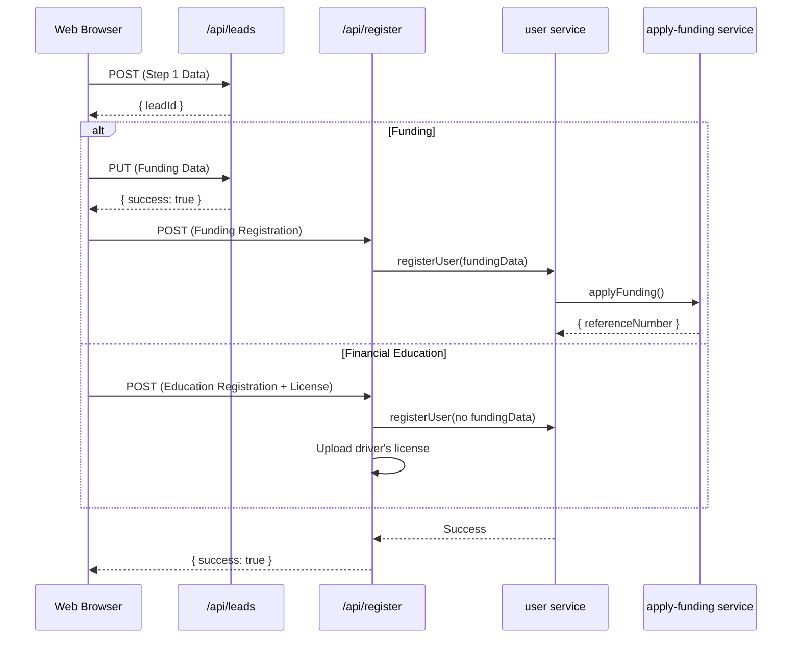

# Public Registration Process

This document outlines the architecture of the public user registration and initial funding application process, rooted at [`app/(public)/register/page.tsx`](<app/(public)/register/page.tsx>).

## Overview

The registration is a client-rendered, multi-path flow orchestrated by [`PublicRegistrationForm()`](../../components/new-registration/PublicRegistrationForm.tsx:39). An initial purpose selector sends the user through either the Funding application process or the shorter Financial Education process.

Key characteristics:

- **Funding:** Personal details, funding details, and conditional financial documents.
- **Financial Education:** Personal details and identity verification only.
- **Client-side state management** via a Zustand store (`useNewRegistrationStore`), which persists form drafts to `localStorage`.
- **Purpose-aware validation** using Zod on both the client and final registration API.
- **Automated data entry** for addresses using an OCR scan of the user's driver's license.
- **Secure submission** with a final review modal before creating the user and funding application records.

## Frontend Architecture

The user interface is managed by [`PublicRegistrationForm()`](../../components/new-registration/PublicRegistrationForm.tsx:39), which combines `registrationPurpose` and `currentStep` from [`useNewRegistrationStore`](../../store/new-registration-store.ts) to determine which screen is shown.

### Data Persistence & Drafts

To prevent data loss, the registration form automatically saves its progress.

- **State Store:** The [`useNewRegistrationStore`](store/new-registration-store.ts) holds the data for each step.
- **Persistence:** The store is partially persisted to `localStorage` under the key `new-registration-storage`, excluding file upload data.
- **Lead Record:** After Step 1, a `user-leads` document is created via a `POST` to [`/api/leads`](app/api/leads/route.ts). Subsequent steps update this lead record via `PUT` requests, ensuring a draft is saved on the backend.

### Initial Purpose Selection

[`RegistrationPurposeStep()`](../../components/new-registration/RegistrationPurposeStep.tsx:35) presents two choices:

- **Apply for Funding** — follows the complete funding application flow.
- **Financial Education** — skips funding selection, business details, paystubs, and bank statements.

Changing the purpose clears funding-specific and document state so data from one branch cannot leak into the other branch.

### Shared Personal Details

#### Personal & Authentication Details

- **Component:** [`<Step1Auth>`](components/new-registration/Step1Auth.tsx)
- **Schema:** [`authSchema`](schema/new-registration.ts:4)
- **Fields:**
  - Full Name
  - Social Security Number
  - Phone Number
  - Email
  - Password
  - Consent to Terms & Privacy Policy
- **Process:**
  1.  User fills out the form.
  2.  On "Next," data is validated against `authSchema`.
  3.  A `POST` request is sent to [`/api/leads`](app/api/leads/route.ts) to create a new lead record, and the returned `leadId` is stored.
  4.  Funding users continue to Funding Details. Financial Education users continue directly to Identity Verification.

### Funding Path

#### Funding & Business Details

- **Component:** [`<Step2BusinessDetails>`](components/new-registration/Step2BusinessDetails.tsx)
- **Schema:** [`businessDetailsSchema`](schema/new-registration.ts:45)
- **Fields:**
  - Funding Amount
  - Funding Type (`Personal`, `Business`, `Both`)
  - Conditional fields based on `fundingType`:
    - **Personal/Both:** Credit Score, Employment Type (`W2`/`Self-employed`).
    - **Business/Both:** Time in Business, Business Name, EIN, Industry.
- **Process:**
  1.  The form adapts based on the "Type of funding" selected.
  2.  On "Next," data is validated against `businessDetailsSchema`.
  3.  A `PUT` request updates the lead record via [`/api/leads`](app/api/leads/route.ts).
  4.  The application transitions to Step 3.

#### Funding Document Upload

- **Component:** [`<Step3FundingDocuments>`](components/new-registration/Step3FundingDocuments.tsx)
- **Schema:** [`documentUploadSchema`](schema/new-registration.ts:186)
- **Fields (Conditional):**
  - Driver's License (All)
  - Paystubs (Personal, W2)
  - Personal Bank Statements (Personal, Self-employed)
  - Business Bank Statements (Business, Both)
  - Personal Address (for credit report)
- **Process:**
  1.  The UI displays the required document uploaders based on selections from Step 2.
  2.  Users upload files, which are held in the client-side Zustand store.
  3.  On "Review Application," files are validated against `documentUploadSchema`.
  4.  A confirmation modal appears, summarizing all entered data.

### Financial Education Path

Financial Education registration does not create a funding application and does not request a funding amount, funding type, employment information, business information, paystubs, or bank statements.

#### Identity Verification

- **Component:** The shared identity section in [`Step3Funding()`](../../components/new-registration/Step3FundingDocuments.tsx:319).
- **Required document:** Driver's license only.
- **OCR:** Uploading the license invokes [`POST /api/ocr`](../../app/api/ocr/route.ts), then fills the editable street, city, state, and postal-code fields.
- **Review:** The confirmation modal shows the registration purpose, personal information, address, and driver's-license status. It does not render funding details.

### OCR Autofill

To accelerate data entry, the system can scan a user's driver's license.

- **Trigger:** Uploading a file to the Driver's License dropzone in Step 3.
- **Endpoint:** A `POST` request is sent to [`/api/ocr`](app/api/ocr/route.ts).
- **Result:** The API returns structured data (name, address), which is then used to populate the address fields in the form and update the `authData` in the store.

### Final Submission

1.  **Confirmation:** The user clicks "Confirm & Join!" in the review modal.
2.  **Aggregation:** All data from the `authData`, `businessDetailsData`, and `documentUploadData` sections of the store is compiled.
3.  **Submission:** A `POST` request is sent to [`/api/register`](../../app/api/register/route.ts) with `registrationPurpose` and the purpose-specific payload.
4.  **Success:** A success message is displayed, the local registration store is cleared, and the user is redirected.

## Backend Architecture

The backend logic is split between lead management ([`/api/leads`](app/api/leads/route.ts)) and final registration ([`/api/register`](app/api/register/route.ts)).

### Flow Diagram

### Lead & Draft Management

- `POST /api/leads`: Creates a new document in the `user-leads` Firestore collection with the data from Step 1.
- `PUT /api/leads`: Updates the existing lead document with merged data from subsequent steps.

### Final Registration Processing

The [`POST()`](../../app/api/register/route.ts:228) handler validates the complete purpose-specific request and calls [`registerUser()`](../../service/user.ts:165).

**`registerUser` Service (`service/user.ts`)**

1.  **Prevents Duplicates:** Checks if a user with the given email already exists.
2.  **Creates Firebase Auth User:** Creates a new user in Firebase Authentication.
3.  **Creates Firestore User:** Creates a new document in the `user` collection with the validated personal data.
4.  **Funding only:** Calls [`applyFunding()`](../../service/apply-funding.ts:192) to create the application and upload its documents.
5.  **Financial Education only:** Skips the business and funding records, then uploads the driver's license through [`uploadDocument()`](../../service/documents.ts:67) with Financial Education metadata.
6.  **Sends Emails:**
    - Triggers an email verification email to the user.
    - Sends a notification to an internal address about the new registration.
7.  **Funding only:** Creates the registration Asana task when a funding reference number exists.
8.  **Updates Lead Status:** Marks the `user-leads` document as "Registered."

The user document and lead retain `registrationPurpose`. Financial Education does not automatically activate a membership or enroll the user in a course. After verification, the verification page sends the user to login; a successful Client login is routed to `/client/home` by [`proxy()`](../../proxy.ts:246).

## Current Implementation Caveats

- **Final Submission CAPTCHA:** The final `POST` to [`/api/register`](app/api/register/route.ts) does not appear to be protected by a CAPTCHA token, unlike the OCR endpoint and older registration flows.
- **Document Upload Failures:** The document processing loop in [`service/apply-funding.ts`](service/apply-funding.ts) catches errors for individual file uploads but continues the process, meaning a registration can succeed even if a required document fails to upload.
- **Account-before-license ordering:** Financial Education creates the user before storing the driver's license. If that storage operation fails, the API returns an error after the account has already been created; retrying with the same email may then produce a duplicate-email error.

## Related & Outdated Documentation

- [`docs/REGISTRATION_FLOW.md`](docs/REGISTRATION_FLOW.md): An earlier version of this document. While conceptually similar, it is outdated and does not reflect the current `PublicRegistrationForm` implementation, Zustand store, or lead-based draft saving.
- [`docs/NEW_REGISTRATION_FLOW.md`](docs/NEW_REGISTRATION_FLOW.md): A planning document or TODO list that outlines the intended structure of the current flow. It should be considered historical.
- [`docs/SELF_REGISTRATION.md`](docs/SELF_REGISTRATION.md): A user-facing guide for the self-registration process.
- [`docs/REGISTRATION_CONVERSION_OPTIMIZATION.md`](docs/REGISTRATION_CONVERSION_OPTIMIZATION.md): A planning document for future enhancements to the registration flow.
