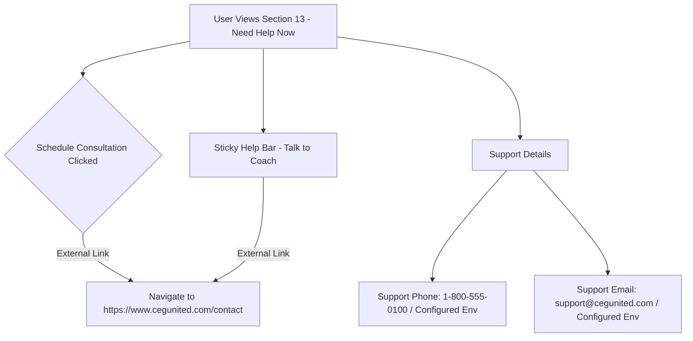

# Contact Link & Support Options Routing Plan

## Objective

Update the "Need Help Now" (Section 13) support options and consultation action button links to route to `https://www.cegunited.com/contact`, ensuring consistent fallback URLs and contact details across the application.

## System Flow

## Key Changes

1. **Playbook Mapper ([`lib/funding-playbook/playbook-mapper.ts`](lib/funding-playbook/playbook-mapper.ts))**:
   - Update `scheduleConsultUrl` default value to `https://www.cegunited.com/contact`.
2. **Funding Playbook Section 13 ([`components/funding-playbook/Sections9to13.tsx`](components/funding-playbook/Sections9to13.tsx))**:
   - Ensure "Schedule Consultation" button opens `https://www.cegunited.com/contact` externally or via configured URL.
3. **Sticky Help Bar ([`components/funding-playbook/StickyHelpBar.tsx`](components/funding-playbook/StickyHelpBar.tsx))**:
   - Ensure sticky consultation trigger links to `https://www.cegunited.com/contact`.
4. **Environment Variables**:
   - Update `CEG_CONSULT_URL` fallback in example configs if needed.

## Execution Steps

1. Update `lib/funding-playbook/playbook-mapper.ts` fallback URL.
2. Verify external link target and attributes in `Sections9to13.tsx` and `StickyHelpBar.tsx`.
3. Check and update any related support contact references.
