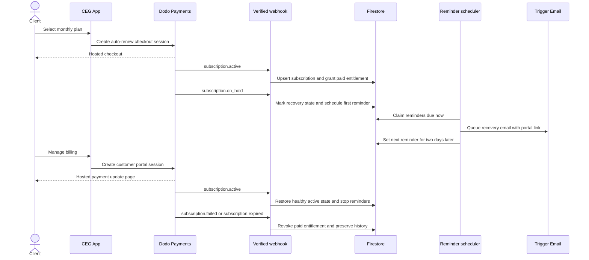

# Dodo Membership Lifecycle, Dunning, and Billing Management Plan

## 1. Purpose and confirmed product policy

This document began as the approved pre-implementation proposal and now serves as the implementation specification. Deployment remains gated by the reconciliation and observe-only rollout described below.

Confirmed policy:

- Memberships renew automatically every month through Dodo Payments.
- A failed renewal enters a recoverable payment state. Paid app access remains available while Dodo performs configured retries.
- The client receives a reminder every two days while payment recovery is pending.
- When retries are exhausted, or Dodo reports the subscription as expired or terminally failed, paid access is removed and the effective app plan becomes Free.
- The paid subscription record and billing history are preserved; the system does not overwrite the historical tier with a fake paid-to-Free subscription mutation.
- Membership Settings displays a payment-failure banner and a Dodo-hosted Manage billing / Update payment method action.
- Subscription-based addons follow the same lifecycle independently: recurring billing, 13-day grace access, reminders every 48 hours, terminal access removal, and separate status display. Membership and addon checkouts reuse one Dodo customer so both can be managed from the same portal.

## 2. Current-state audit

### Checkout

- [`PricingPlans`](../components/pricing-plans/PricingPlans.tsx) only selects a tier and invokes its caller-provided callback. It should remain a presentation component.
- Existing callers use [`createMembershipCheckoutConfig()`](../service/dodo/index.ts:228).
- The checkout currently sends `subscription_data.on_demand` through [`createSession()`](../service/dodo/index.ts:90). This creates an on-demand charging model and does not express the intended ordinary monthly auto-renewal policy.
- Both [`recordPaymentSucceeded()`](../service/dodo/index.ts:437) and [`recordSubscriptionActive()`](../service/dodo/index.ts:602) can activate membership. Membership entitlement should be authoritative from verified subscription lifecycle events, not browser checkout completion or an ambiguous payment event.

### Webhooks and membership state

- [`handleDodoPayload()`](../app/api/payments/dodo/route.ts:33) handles only `payment.succeeded` and `subscription.active`.
- Webhook deduplication exists, but event identity currently supports only those two event types.
- [`activateUserMembership()`](../service/membership.ts:59) stores a minimal `active` record. It currently overloads checkout/receipt fields for subscription activation and does not store Dodo status, subscription ID, billing dates, retry state, or reminder state.
- [`getUserMembership()`](../service/membership.ts:246) reads the newest membership by `createdAt`; it does not calculate a distinct entitlement/effective plan.
- [`proxy()`](../proxy.ts:221) and several server services use `membership.status === active` for paid access. This is a useful centralized convention, but the status must be synchronized correctly and cache invalidation must happen on every lifecycle transition.

### Billing management and cancellation

- An authenticated Dodo Customer Portal endpoint already exists at [`GET`](../app/api/user/[userId]/dodo/customer-portal/route.ts:13).
- [`MembershipPage()`](<../app/(settings)/settings/membership/page.tsx:17>) does not expose that endpoint.
- [`cancelUserMembership()`](../service/membership.ts:295) only changes Firestore. It does not cancel the Dodo subscription and can therefore cause billing/access drift. Customer-initiated cancellation should go through Dodo Customer Portal, with the verified webhook synchronizing local state.

### Email and scheduling

- Email delivery already uses the Firebase Trigger Email extension through [`sendTriggerEmail()`](../service/trigger-email.ts:15).
- [`EmailJobs`](../schema/trigger-email.ts:18) has no membership-payment reminder category.
- The Firebase Functions package has no scheduled billing/dunning function in [`functions/src/index.ts`](../functions/src/index.ts:1).

## 3. Target architecture

## 4. Subscription and entitlement model

Use Dodo's provider status and the app's effective entitlement as related but separate concepts.

### Provider lifecycle fields

Extend the canonical current membership document at `user/{userId}/membership/current` with:

| Field                     | Purpose                                                                     |
| ------------------------- | --------------------------------------------------------------------------- |
| `provider`                | `dodo`                                                                      |
| `subscriptionId`          | Stable Dodo subscription identifier                                         |
| `customerId`              | Stable Dodo customer identifier                                             |
| `productId`               | Dodo product for the selected tier                                          |
| `tier`                    | Last paid tier: Starter, Pro, or Executive                                  |
| `providerStatus`          | `pending`, `active`, `on_hold`, `cancelled`, `failed`, or `expired`         |
| `entitlementStatus`       | `paid`, `grace`, or `free`                                                  |
| `status`                  | Compatibility projection: `active` for `paid`/`grace`, otherwise `inactive` |
| `currentPeriodStart`      | Provider billing period start when available                                |
| `currentPeriodEnd`        | Provider billing period end / access boundary when available                |
| `nextBillingDate`         | Next provider renewal date when available                                   |
| `cancelAtNextBillingDate` | Whether cancellation is scheduled                                           |
| `paymentFailureStartedAt` | First transition into the current recovery episode                          |
| `retryAccessUntil`        | Explicit grace/retry boundary used by the app                               |
| `nextReminderAt`          | Next eligible recovery reminder time                                        |
| `lastReminderAt`          | Last successfully queued reminder time                                      |
| `reminderCount`           | Number sent in the current recovery episode                                 |
| `lastWebhookEventId`      | Audit/debug reference                                                       |
| `updatedAt`               | Last local synchronization time                                             |

Preserve an append-only transition/audit collection keyed by webhook ID or event identity. Existing webhook claim documents can be enhanced with subscription ID, user ID, event type, processing timestamps, and final outcome.

### Effective access rules

| Dodo condition                                       | App entitlement        | Compatibility `status` | Reminder behavior                               |
| ---------------------------------------------------- | ---------------------- | ---------------------- | ----------------------------------------------- |
| `active`                                             | `paid`                 | `active`               | Stop/reset recovery reminders                   |
| `on_hold` and before `retryAccessUntil`              | `grace`                | `active`               | Every two days                                  |
| `cancelled` at period end, before `currentPeriodEnd` | `paid`                 | `active`               | None unless payment also fails                  |
| `cancelled` immediately                              | `free`                 | `inactive`             | None                                            |
| `failed`                                             | `free`                 | `inactive`             | Stop recovery sequence; optional final notice   |
| `expired`                                            | `free`                 | `inactive`             | Stop recovery sequence                          |
| `on_hold` after `retryAccessUntil`                   | `free` safety fallback | `inactive`             | Stop repeating and optionally send final notice |

The client remains authenticated on Free. Only paid routes and paid server operations are denied. Existing public/free pages remain available.

## 5. Checkout correction

Change membership checkout only; do not alter on-demand behavior for unrelated products.

1. Remove the `onDemand: true` membership option from [`createMembershipCheckoutConfig()`](../service/dodo/index.ts:228).
2. Create the session against Dodo products configured as monthly recurring products.
3. Continue attaching `userId`, `planId`, and membership metadata for deterministic webhook correlation.
4. Validate plan IDs on the server and continue deriving price/product from trusted server settings rather than accepting the amount supplied by [`PricingPlans`](../components/pricing-plans/PricingPlans.tsx).
5. Do not grant entitlement from the return URL or checkout UI completion. The verified `subscription.active` webhook is authoritative.
6. Reassess `payment.succeeded` activation: retain it for recording payment history and one-time products, but do not use it by itself to grant or renew membership access.

## 6. Webhook lifecycle processing

Expand [`handleDodoPayload()`](../app/api/payments/dodo/route.ts:33) to claim and process:

- `subscription.active`: upsert provider identifiers/status, grant `paid`, clear failure/reminder fields, and invalidate membership cache.
- `subscription.renewed`: update billing dates, keep `paid`, clear recovery state, and record renewal.
- `subscription.on_hold`: preserve access as `grace`, set `paymentFailureStartedAt`, calculate/store `retryAccessUntil`, and set `nextReminderAt` to the chosen first-reminder time.
- `subscription.cancelled`: inspect `cancel_at_next_billing_date`; preserve paid access through period end or revoke immediately.
- `subscription.plan_changed`: map product ID to tier only after inspecting the actual current product and subscription state.
- `subscription.failed`: mark `free`/`inactive`, stop reminders, invalidate cache.
- `subscription.expired`: mark `free`/`inactive`, stop reminders, invalidate cache.

Processing requirements:

- Generate a stable deduplication key for every supported event. Prefer the provider webhook ID supplied by verified headers when the framework exposes it; otherwise combine event type, subscription ID, and an event-specific timestamp/version.
- Make transitions monotonic: an older delayed `on_hold` event must not overwrite a newer `active` recovery.
- Store provider event time and compare it transactionally before applying state.
- Resolve users primarily from persisted `subscriptionId`/`customerId` mappings; use metadata/payment history only as migration fallbacks.
- Return success for already-processed events.
- On processing failure, retain a retryable failure record rather than silently losing the event.

## 7. Retry window and downgrade boundary

Dodo retry configuration is an operational dependency, not an application guess.

Before rollout, configure Dodo Recovery payment retries for the selected window and record that duration as an application configuration value. The application stores `retryAccessUntil` when `subscription.on_hold` arrives. Terminal `subscription.failed` or `subscription.expired` events revoke access immediately; a scheduled reconciliation also revokes access if a subscription remains `on_hold` beyond `retryAccessUntil`.

This safety reconciliation is required because provider dunning emails and provider payment retry state transitions are separate concerns, and webhook delivery can be delayed or missed.

Recommended configuration:

- `DODO_RETRY_WINDOW_DAYS`: must match the Dodo dashboard Recovery setting.
- First app reminder: immediately when `on_hold` is processed, or at the first scheduler run after it.
- Subsequent reminders: only when `now >= nextReminderAt`, with `nextReminderAt = successfullyQueuedAt + 48 hours`.
- Stop reminders on `active`, `failed`, `expired`, immediate cancellation, or when `retryAccessUntil` is reached.

## 8. Two-day reminder scheduler

Recommended implementation: a Firebase v2 scheduled function that runs periodically, but sends only records whose `nextReminderAt` is due. It should use the same named Firestore database as the app and write to the existing Trigger Email `mail` collection.

Scheduler algorithm:

1. Query membership documents where `entitlementStatus == grace` and `nextReminderAt <= now`.
2. Process in bounded batches.
3. In a transaction, re-read and claim each due reminder using a lease/idempotency key such as `subscriptionId:paymentFailureStartedAt:reminderCount`.
4. If `retryAccessUntil <= now`, project the membership to Free/inactive and do not send another recovery reminder.
5. Otherwise queue one email, then set `lastReminderAt`, increment `reminderCount`, and move `nextReminderAt` by exactly 48 hours.
6. Release/retry failed claims safely. Never send twice for the same reminder sequence number.

Add a dedicated `MEMBERSHIP_PAYMENT_RETRY` value to [`EmailJobs`](../schema/trigger-email.ts:18). Email content should include:

- The failed-renewal context without exposing card data.
- The date paid access may end.
- A server-generated link to Membership Settings, where a fresh portal session is created on demand.
- Support contact details.

Do not place a 24-hour Dodo portal URL directly into a repeating two-day email. Link to the app's Membership Settings page because Dodo portal links expire.

Required Firestore indexes should be added for the collection-group query over entitlement/recovery state and due time.

## 9. Update payment information and billing UI

Use Dodo Customer Portal rather than collecting or storing payment card details in CEG.

Update [`MembershipPage()`](<../app/(settings)/settings/membership/page.tsx:17>) to:

- Show the effective plan, last paid tier, provider status, next billing date, and access-through/retry deadline when present.
- Render an amber/red recovery banner for `on_hold`/`grace` with a clear Update payment method action.
- Render a Manage billing action for healthy active memberships.
- Call the existing authenticated portal route and follow its redirect to a newly generated Dodo portal session.
- Handle no-customer, expired-session, and provider errors with actionable messages.
- Replace or retire the Firestore-only cancellation button. Cancellation must occur in Dodo Portal so billing and local access stay synchronized through webhooks.

The app and database must never receive raw card numbers, CVC, or full payment credentials.

## 10. Access-control hardening

Maintain `status === active` temporarily as a compatibility projection so current gates keep working. Introduce one canonical helper, for example `hasPaidMembershipAccess`, and migrate access decisions to it.

Apply it consistently to:

- Page-level routing in [`proxy()`](../proxy.ts:221).
- Server actions and API routes that currently perform their own membership checks.
- UI visibility only as a convenience, never as the sole authorization control.

The helper should grant access only for `paid`, or `grace` before `retryAccessUntil`. It should fail closed for malformed/unknown states. Every lifecycle mutation must invalidate [`membershipCache`](../lib/membership-cache.ts).

## 11. Migration and rollout

Existing on-demand memberships cannot safely be assumed to become normal auto-renewing subscriptions merely by changing future checkout code.

Rollout sequence:

1. Configure monthly recurring products and Recovery settings in Dodo test mode.
2. Deploy expanded webhook handling and storage fields before changing checkout.
3. Backfill known `subscriptionId`, `customerId`, product, status, and billing dates from Dodo for existing memberships.
4. Classify legacy memberships that lack a recoverable recurring mandate. Do not auto-charge or revoke them without an explicit migration policy.
5. Switch new membership checkout sessions to normal recurring subscriptions.
6. Enable billing UI and recovery banner.
7. Enable scheduler in observe-only mode, then email mode, then deadline-based downgrade mode after validating query/index/database configuration.
8. Monitor webhook failures, duplicate suppression, reminders sent, recoveries, and downgrade counts.

## 12. Test plan

### Unit and service tests

- Monthly checkout omits on-demand configuration and uses trusted recurring product mappings.
- `payment.succeeded` records payments but cannot independently grant membership.
- Every supported subscription event maps to the correct provider and entitlement states.
- Out-of-order events cannot regress recovered subscriptions.
- Cache invalidation occurs on active, grace, and free transitions.
- Existing Free users remain able to use free routes but cannot use paid operations.

### Webhook tests

- Signature verification remains mandatory.
- Each event is idempotent under duplicate delivery and concurrent delivery.
- `cancelled` distinguishes immediate cancellation from period-end cancellation.
- `on_hold -> active` stops reminders and retains/restores access.
- `on_hold -> failed` and `on_hold -> expired` revoke paid access.

### Scheduler and email tests

- First reminder is queued once.
- No reminder is sent before 48 hours.
- Exactly one reminder is sent per due sequence under concurrent scheduler runs.
- Recovery and terminal events stop future reminders.
- Passing the retry deadline projects effective Free access even if a terminal webhook is absent.
- Email links route to authenticated Membership Settings rather than embedding expiring portal sessions.

### UI and authorization tests

- Healthy subscribers can open Manage billing.
- Grace-state clients see the banner, access deadline, and Update payment method action.
- Portal errors are displayed safely.
- After terminal downgrade, paid page routes redirect and paid APIs reject access.
- After payment recovery and `subscription.active`, access returns without a new checkout.

## 13. Implementation packages for approval

### Package A — Lifecycle foundation

- Correct monthly checkout.
- Expand membership schema/service and all subscription webhooks.
- Separate provider state from entitlement state.
- Harden access calculation and tests.

This package is mandatory for reliable auto-renewal and downgrade behavior.

### Package B — Payment recovery communication

- Add retry-window configuration.
- Add due-reminder state and Firestore index.
- Add scheduled reconciliation and every-two-day Trigger Email reminders.
- Add observability and concurrency/idempotency tests.

This package implements requirements 1 and 2 fully when combined with Package A.

### Package C — Customer billing management

- Add Membership Settings status/banner UI.
- Connect Manage billing / Update payment method to the existing Dodo Customer Portal route.
- Replace local-only cancellation with provider-managed cancellation.

This package implements requirement 3 and prevents billing drift.

### Package D — Legacy migration and controlled rollout

- Build reconciliation/backfill tooling for existing on-demand memberships.
- Add observe-only reporting and phased scheduler enforcement.
- Document Dodo dashboard configuration and operational runbook.

This package is strongly recommended before production enforcement against existing clients.

## 14. Approved implementation decisions

The full scope—Packages A, B, C, and D—is approved with these decisions:

1. Use a 13-day retry window. The Dodo dashboard Recovery setting and `DODO_RETRY_WINDOW_DAYS=13` must match before enforcement is enabled.
2. Send the first recovery reminder at the first scheduled-function run after `subscription.on_hold`, then no more often than every 48 hours.
3. Send one separate, non-repeating access-ended email when the effective plan transitions to Free.
4. Inventory and reconcile legacy on-demand memberships before enforcing renewal or downgrade behavior against them. Never silently convert, auto-charge, or revoke a legacy membership.
5. Display `Free` as the effective app plan after access ends while retaining the last paid tier and provider history.
6. Roll out enforcement only after observe-only reconciliation confirms Dodo/Firestore mappings and retry deadlines.
