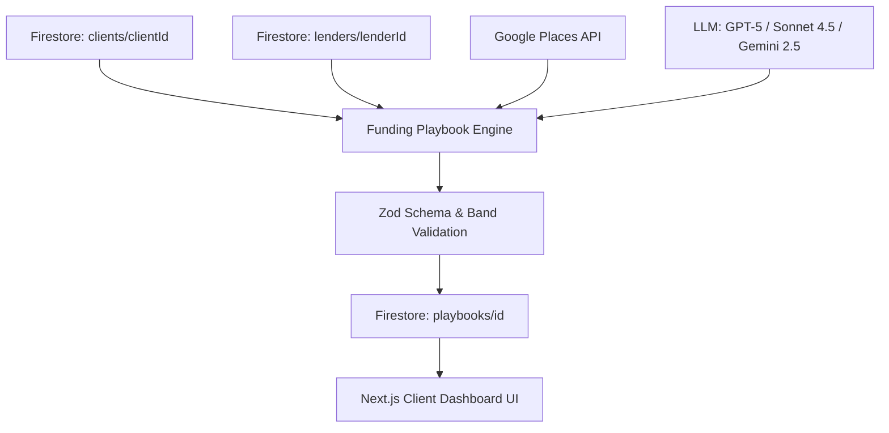

# CEG Funding Playbook Implementation Plan

## 1. Executive Summary & Architecture Overview

The **CEG Funding Playbook** is a data-driven, AI-assisted decision engine that generates a personalized 13-section approval strategy for CEG clients applying to specific lenders and credit products.

### Core Architecture Principles

1. **Ground Truth First (70%+)**:
   - **Client Data**: FICO, utilization, open tradelines, income, DTI, existing lender relationships, enrolled CEG services.
   - **Curated Lender Data**: Bureau pulls, double-dip rules, 3-day rules, FICO ranges, DDA requirements, reconsideration phone numbers, common denial reasons.
   - **Google Places API**: Live 5 nearest branch locations by ZIP code with hours and phone numbers.
2. **AI Gap Filling (~30%)**:
   - Swappable LLM provider (`REASONING_MODEL`: `gpt-5`, `claude-sonnet-4.5`, or `gemini-2.5-pro`).
   - Personalizes approval odds within ±30% documented lender bands, recommends stated income, calculates business structuring math, provides risk mitigations, ranks CEG service lift, and generates a 4-sentence reconsideration phone script.
3. **Fail-Safe Zod Validation**:
   - All LLM outputs are validated against Zod schemas (`AIPlaybookReasoningOutputSchema` and `AIReconsiderationScriptOutputSchema`). Fallback outputs prevent system failure if AI calls fail or produce invalid JSON.

---

## 2. Comprehensive 13-Section Playbook Specification

1. **Section 1: Best Method & Strategy Overview** (Curated + AI Note)
2. **Section 2: Lender & Product Requirements** (Curated)
3. **Section 3: Bureau Pull & Velocity Rules** (Curated)
4. **Section 4: Personalized Approval Odds & Band** (AI Reasoning + Zod Clamped Range)
5. **Section 5: Stated Income & Reg B Guidance** (Curated + AI Guidance)
6. **Section 6: Business Income Structuring Math** (AI Math Reasoning)
7. **Section 7: Denial Risks & Mitigation Steps** (Curated + AI Risk Personalization)
8. **Section 8: CEG Product Recommendations & Lift** (Curated + AI Ranking)
9. **Section 9: In-Branch Locations & Booking** (Google Places API + Leaflet Map)
10. **Section 10: Phone Reconsideration Script & Numbers** (Curated Phone + 4-Sentence AI Script)
11. **Section 11: Timing & Application Sequence** (Curated + AI Rationale)
12. **Section 12: Next Steps & Application Checklist** (Curated)
13. **Section 13: Closing Note & Client Feedback** (AI Closing Note + Feedback API)

---

## 3. Implementation Roadmap

### Phase 1: Database Setup & Seeding

- Deploy / adapt Firestore Security Rules (`firestore.rules`) and Composite Indexes (`firestore.indexes.json`).
- Seed 8 initial curated lenders into Firestore (`chase`, `american-express`, `capital-one`, `bank-of-america`, `us-bank`, `navy-federal`, `pnc`, `wells-fargo`) using `lender-data/seed-lenders.ts`.

### Phase 2: Backend Integration in Next.js (`ceg-united-app`)

- Create route handlers under `app/api/funding-playbook/`:
  - `POST /api/funding-playbook/generate` (Generate / fetch 24h cached playbook)
  - `POST /api/funding-playbook/branches` (Google Places 5 nearest branches, 7d cache)
  - `POST /api/funding-playbook/reconsideration-script` (Personalized script, 24h cache)
  - `POST /api/funding-playbook/feedback` (Submit rating & notes)
- Port helper modules to `lib/funding-playbook/`:
  - `ai-router.ts` (LLM handler for GPT-5 / Claude / Gemini)
  - `prompt-builder.ts` (DATA/INSTRUCTIONS prompt generator)
  - `schemas.ts` (Zod validation schemas)
  - `places.ts` (Google Places API client)
  - `rate-limit.ts` (Daily rate limiter per client)

### Phase 3: Frontend UI Integration

- Port React components from `new-feature/ceg-funding-playbook/playbook/src/components/` to `components/funding-playbook/`:
  - `PlaybookHeader.tsx`, `ProgressRing.tsx`, `SectionNav.tsx`, `BranchMap.tsx` (using Leaflet / CARTO Light tiles).
  - `Sections1to4.tsx`, `Sections5to8.tsx`, `Sections9to13.tsx`, `StickyHelpBar.tsx`.
- Add dedicated Next.js client route `/dashboard/funding-playbook` or embed into existing client application dashboard.
- Connect `usePlaybook` hook to live `/api/funding-playbook/generate` endpoint.

### Phase 4: Testing & Verification

- Unit test schemas and Zod validation using Vitest (`__tests__/service/funding-playbook.test.ts`).
- End-to-end test playbook generation flow, fallback handling when AI fails, and Google Places caching.
- Verify responsiveness (Desktop 1440px / Mobile 390px) and print styling (`@media print`).

---

## 4. Environment Variables Required

- `GOOGLE_PLACES_API_KEY`: For Google Places API (Text Search + Place Details).
- `REASONING_MODEL`: `gpt-5`, `claude-sonnet-4.5`, or `gemini-2.5-pro`.
- `OPENAI_API_KEY` / `ANTHROPIC_API_KEY` / `GOOGLE_GENERATIVE_AI_API_KEY`: Key corresponding to selected AI model.
- `GENERATE_PLAYBOOK_DAILY_LIMIT`: Default 20 calls/client/day.
