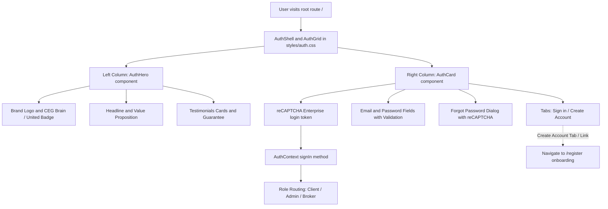

# Dark Cinematic Login Page Implementation Plan

## Overview

Implement the new dark cinematic authentication experience sourced from `ui_mods/ceg-auth-page/src` into `ceg-united-app` while removing all Google Sign-In elements and preserving the existing authentication and security architecture (reCAPTCHA Enterprise, session cookie management, role-based navigation, and forgot password flow).

---

## Architectural Workflow

---

## Key Files to Create and Update

1. **[`styles/auth.css`](styles/auth.css)**:
   - Contains design tokens for background glows, dark card surfaces, border treatments, buttons, inputs, spinner, and responsive grid layouts.

2. **[`lib/auth-errors.ts`](lib/auth-errors.ts)**:
   - Humanizes Firebase Auth error codes into friendly user feedback sentences.

3. **[`lib/validation.ts`](lib/validation.ts)**:
   - Provides lightweight client-side validators for email, password strength, and names.

4. **[`components/Icons.tsx`](components/Icons.tsx)**:
   - Self-contained SVG icons (`MailIcon`, `LockIcon`, `UserIcon`, `EyeIcon`, `EyeOffIcon`, `AlertIcon`, `ShieldIcon`) without third-party icon library dependencies. Google icon is omitted.

5. **[`components/AuthHero.tsx`](components/AuthHero.tsx)**:
   - Hero section showcasing CEG United branding, headline ("Get funded. Not guessed."), social proof testimonials, and platform guarantee.

6. **[`components/AuthCard.tsx`](components/AuthCard.tsx)**:
   - Interactive login form component.
   - **Google Sign-In is completely removed** (no Google button, popup/redirect handling, or Google provider dependency).
   - Integrates with [`provider/AuthContext.tsx:signIn`](provider/AuthContext.tsx:181) and [`lib/captcha/index.ts:getCaptchaTokenRegistration`](lib/captcha/index.ts:1).
   - Integrates `<ForgotPassword>` dialog with reCAPTCHA assessment.
   - Includes "Create account" routing to the registration wizard at `/register`.

7. **[`app/(public)/landing-page.tsx`](<app/(public)/landing-page.tsx>) / [`app/(public)/page.tsx`](<app/(public)/page.tsx>)**:
   - Updated to render the new `<AuthHero />` and `<AuthCard />` inside `.auth-shell` and `.auth-grid`.
   - Replaces the legacy carousel + white card layout.
