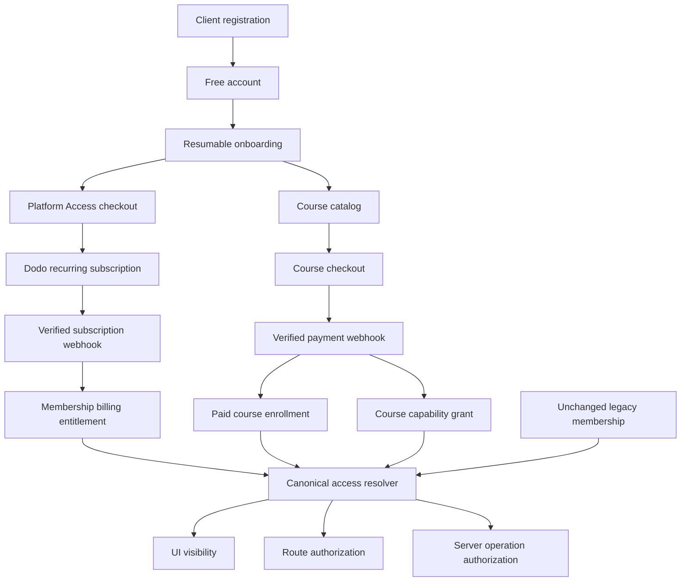

# Platform Membership and Course Entitlements Implementation Plan

## 1. Purpose

Replace the customer-facing Starter, Pro, and Executive membership choices with one configurable **CEG Brain Platform Access** subscription, initially **$499 per month**, while preserving every current member's stored membership, provider subscription, price, billing lifecycle, and effective access.

The platform will use two independent entitlement dimensions:

1. **Platform access** — an active paid or grace-state membership opens the paid platform baseline.
2. **Course capability grants** — verified course purchases add cumulative tool permissions without changing the membership subscription.

This separation is necessary because the current [`UserMembership`](../schema/users.ts:21) combines billing state and a legacy tier, while course purchases currently create enrollment only in [`recordPaymentSucceeded()`](../service/dodo/index.ts:448).

## 2. Confirmed product policy

- A newly registered Client starts on Free.
- Income-based funding remains available on Free.
- Audit, diagnostic/analysis, credit-report, and non-income-based funding features require active Platform Access.
- Platform Access is a monthly recurring subscription whose fee is controlled by an admin setting and defaults to $499.
- A course is not required before purchasing Platform Access.
- Courses are optional, separately purchased upgrades.
- Course content does not cascade: purchasing Course 4 does not enroll the client in Courses 1–3.
- Tool permissions do cascade upward as described in the matrix below.
- Only verified paid course purchases create automatic capability grants.
- A manual course enrollment does not implicitly create a capability grant. Admins receive a separate, explicit grant/revoke action with audit metadata.
- A course-derived tool permission is usable only while Platform Access is paid or in a valid grace period. The purchased course content remains associated with its enrollment independently of membership billing.
- Existing members retain their legacy access only while their unchanged existing subscription is paid or in grace.
- No migration may rewrite an existing member's tier, amount, product, subscription ID, customer ID, provider state, or billing dates.

## 3. Entitlement matrix

| Client state                      | Learning access               | Platform baseline                                                         | Dispute module                        | Legacy Starter tools | Legacy Pro tools | Legacy Executive tools |
| --------------------------------- | ----------------------------- | ------------------------------------------------------------------------- | ------------------------------------- | -------------------- | ---------------- | ---------------------- |
| Free, no purchase                 | Free/previews only            | Income-based funding only                                                 | No                                    | No                   | No               | No                     |
| Active Platform Access only       | Owned courses                 | Audit, diagnostic/analysis, credit report, and approved baseline features | No                                    | No                   | No               | No                     |
| Active Platform Access + Course 1 | Course 1 only                 | Yes                                                                       | Yes                                   | No                   | No               | No                     |
| Active Platform Access + Course 2 | Course 2 only                 | Yes                                                                       | No unless Course 1 was also purchased | Yes                  | No               | No                     |
| Active Platform Access + Course 3 | Course 3 only                 | Yes                                                                       | No unless Course 1 was also purchased | Yes                  | Yes              | No                     |
| Active Platform Access + Course 4 | Course 4 only                 | Yes                                                                       | No unless Course 1 was also purchased | Yes                  | Yes              | Yes                    |
| Paid/grace legacy Starter         | Existing learning rules       | Existing access unchanged                                                 | Existing behavior unchanged           | Yes                  | No               | No                     |
| Paid/grace legacy Pro             | Existing learning rules       | Existing access unchanged                                                 | Existing behavior unchanged           | Yes                  | Yes              | No                     |
| Paid/grace legacy Executive       | Existing learning rules       | Existing access unchanged                                                 | Existing behavior unchanged           | Yes                  | Yes              | Yes                    |
| Any expired/failed membership     | Owned courses remain recorded | Income-based funding only                                                 | No                                    | No                   | No               | No                     |

Course catalog configuration must identify the four canonical products by a stable machine key rather than title or payment amount:

| Course key          | Initial display name         | Initial price | Capability grant                          |
| ------------------- | ---------------------------- | ------------: | ----------------------------------------- |
| `credit_to_capital` | Credit to Capital            |        $2,000 | Dispute module                            |
| `first_50k`         | How to Raise Your First $50K |        $5,000 | Starter permission set                    |
| `funding_150k`      | How to Access Up to $150K    |       $15,000 | Starter + Pro permission sets             |
| `funding_250k_plus` | How to Access $250K+         |       $25,000 | Starter + Pro + Executive permission sets |

Prices remain course configuration, not authorization identifiers.

## 4. Target architecture

## 5. Data model strategy

### 5.1 Preserve legacy membership records

Keep the legacy identifiers in [`MembershipTier`](../schema/users.ts:8) for backward compatibility. Do not delete or rename existing values in storage or provider metadata.

Extend the application type to recognize a new internal billing-plan identifier such as `platform_access`. New subscriptions write this identifier; existing records continue to expose `tier_starter`, `tier_pro`, or `tier_executive` unchanged.

Add an explicit model discriminator such as:

- `accessModel: legacy_tier | platform_course`
- `billingPlan: platform_access` for new clients

The resolver must infer `legacy_tier` when these fields are absent, so historical documents require no backfill.

### 5.2 Add stable course capability configuration

Extend [`courseSchema`](../schema/educational-materials/course.ts:95) with admin-controlled fields:

- `courseKey`
- `capabilityGrant`
- `grantEnabled`

Allowed grants should be a closed server-side enum, not arbitrary strings. Course titles, prices, URLs, and payment amounts must never determine authorization.

### 5.3 Separate enrollment from authorization

Continue using [`UserCourseEnrollmentSchema`](../schema/educational-materials/course.ts:222) to represent access to course content.

Add durable entitlement evidence either as fields on the enrollment or as a dedicated per-user grant record. The record must include:

- user and course IDs
- course key and normalized grant
- source: verified Dodo payment, verified Lumino payment, or explicit admin grant
- provider payment/event ID where applicable
- grant/revoke timestamps
- actor and reason for admin actions
- active/revoked state

Use deterministic IDs or a transactional uniqueness check so duplicate webhooks cannot duplicate grants.

### 5.4 Add platform pricing without deleting legacy fees

Add `platformAccessPrice`, defaulting to 499, to [`FeeSettings`](../service/fee-settings.ts:7). Keep all three legacy price fields readable so old records, reports, and rollback paths remain compatible. Hide legacy tier price controls from normal customer-facing and new-sale workflows; label them Legacy in admin-only operational views rather than deleting them during this migration.

## 6. Canonical authorization model

Create one server-safe resolver, for example `resolveClientEntitlements`, that returns normalized capabilities rather than exposing raw billing tiers to feature code.

Inputs:

- result of [`getUserMembership()`](../service/membership.ts:403)
- verified active course grants
- explicit admin grants
- global feature switches
- current time for grace-period evaluation

Outputs should include:

- `hasPlatformAccess`
- `hasIncomeFundingAccess`
- `hasAuditAccess`
- `hasAnalysisAccess`
- `hasCreditReportAccess`
- `hasDisputeAccess`
- `legacyPermissionLevel: none | starter | pro | executive`
- granular funding category/lender/tool capabilities derived from that level
- reason/evidence metadata for diagnostics

Resolution order:

1. Determine paid/grace membership access using [`hasPaidMembershipAccess()`](../lib/membership-entitlement.ts:12).
2. If access is not paid/grace, return Free capabilities regardless of stored legacy or course grants.
3. If the record is legacy, project its unchanged tier into the corresponding cumulative legacy permission level.
4. If the record is `platform_course`, grant baseline Platform Access.
5. Merge all active verified/admin course grants using maximum legacy permission level plus independent flags such as dispute access.
6. Apply global kill switches last.

Both page routing and server actions/API operations must call the same resolver. UI hiding is informational and must not be the security boundary.

## 7. Checkout and webhook changes

### 7.1 New Platform Access checkout

Refactor [`createMembershipCheckoutConfig()`](../service/dodo/index.ts:239) to accept only the new customer-facing Platform Access plan for new sales.

- Use a dedicated recurring Dodo product such as `DODO_PRODUCT_MEMBERSHIP_PLATFORM_ID`.
- Derive the amount on the server from `platformAccessPrice`; never trust a browser amount.
- Include deterministic metadata: user ID, `billingPlan=platform_access`, `accessModel=platform_course`, and configured membership amount.
- Continue using verified `subscription.active` and lifecycle webhooks as the membership source of truth.
- Keep the old product-to-tier mapping in [`membershipTierForProduct()`](../service/dodo/index.ts:226) for existing subscription events.
- Extend webhook classification to recognize the new product without altering legacy synchronization.

### 7.2 Course payment fulfillment

Refactor the Dodo course branch in [`recordPaymentSucceeded()`](../service/dodo/index.ts:520) and the Lumino fulfillment path so one idempotent transaction:

1. verifies a succeeded provider payment,
2. resolves the exact course by stable course ID/key,
3. creates or updates paid enrollment evidence,
4. creates the matching capability grant,
5. increments enrollment metrics only for a genuinely new enrollment,
6. records the provider event/payment ID.

Do not grant permissions from the checkout return URL, browser completion event, course title, or price matching. Lumino's current fallback matching by amount must not be considered sufficient authorization evidence for capability grants; ambiguous matches must be quarantined for admin review.

### 7.3 Admin grant path

Add a dedicated admin-only capability action separate from course assignment. Require confirmation, reason, actor ID, audit timestamps, and explicit grant/revoke semantics. Assigning a course for support or preview purposes must not silently unlock financial tools.

## 8. Customer experience and onboarding

Implement a short onboarding flow because [`AuthContext`](../provider/AuthContext.tsx:242) currently sends Clients directly to the home page and the earlier onboarding redirect is commented out.

Recommended onboarding:

1. **Welcome and Free access** — explain that the account is active and income-based funding remains free.
2. **Platform Access** — show the variable monthly price and the baseline paid features, with a secure checkout CTA and a skip option.
3. **Education pathway** — show the four courses, their individual content, and the additional tools each purchase unlocks.
4. **Start dashboard** — summarize current access and recommended next action.

Requirements:

- resumable and versioned, not an unskippable payment wall
- shown once after first Client registration/login, with a persistent access-center entry later
- legacy members bypass sales onboarding and see their existing access summary
- checkout completion does not optimistically unlock access; show a processing state until the webhook updates entitlement
- Free users see a dismissible dashboard banner and contextual locked-feature panels
- locked-route redirects return to a dedicated access page with a reason and relevant CTA instead of silently returning home
- membership and course cards use customer language; Starter/Pro/Executive names remain hidden

Replace all customer uses of [`PricingPlans`](../components/pricing-plans/PricingPlans.tsx:20) with a single Platform Access offer and separate course progression cards. Update the many current checkout callers rather than retaining three-tier selection callbacks.

## 9. Legacy compatibility safeguards

- Do not run a destructive membership migration.
- Do not change existing Dodo products or subscriptions as part of application deployment.
- Do not recompute existing members at the new $499 amount.
- Continue processing legacy product IDs and metadata in all subscription lifecycle events.
- Preserve the existing paid/grace/terminal behavior and retry window.
- Treat missing `accessModel` as legacy.
- Keep legacy type values, fee fields, tests, and operational visibility until a separately approved retirement project.
- Add read-only reporting that compares each existing member's pre-deployment and post-deployment resolved capabilities.
- Put the new-sale UI and new entitlement enforcement behind independently reversible feature flags.

## 10. Implementation sequence

### Phase 1 — Contract and schema foundation

- Add normalized billing-plan, access-model, course-key, and capability-grant types.
- Add `platformAccessPrice` with a backward-compatible default.
- Define the canonical entitlement resolver and cumulative merge rules.
- Add schema validation for stable course configuration and grant records.

### Phase 2 — Compatibility-first backend

- Update membership synchronization to support both legacy tier subscriptions and new Platform Access subscriptions.
- Preserve legacy event mapping and fields exactly.
- Add course grant fulfillment for verified Dodo and Lumino payments.
- Add explicit audited admin grant/revoke operations.
- Invalidate relevant membership/entitlement caches after every membership or grant mutation.

### Phase 3 — Authorization enforcement

- Inventory every route, API, service action, lender list, funding category, report action, and dispute operation currently guarded by membership, addon, or tier checks.
- Replace direct raw-tier and `status === active` decisions with the canonical resolver.
- Keep income-based funding available on Free.
- Enforce Platform Access for audit, analysis, credit reports, and non-income funding.
- Enforce Course 1 for disputes and cumulative Course 2–4 funding permission sets.
- Retain global feature switches as final deny overrides.

### Phase 4 — Admin and customer UI

- Replace the three-card membership chooser with one variable-price Platform Access card.
- Add admin configuration for Platform Access price and course capability mapping.
- Retain legacy pricing as clearly marked operational data, not new-sale options.
- Update Membership Settings to show Platform Access, billing lifecycle, owned courses, and unlocked capabilities without exposing internal tiers.
- Add the onboarding flow, access center, dashboard banner, locked states, and course upgrade recommendations.

### Phase 5 — Migration validation and rollout

- Snapshot legacy membership identity, billing fields, and resolved permissions before deployment.
- Deploy additive schema/resolver code first with customer UI unchanged.
- Run entitlement comparison in observe-only mode and resolve every regression.
- Configure and test the new recurring Dodo product in test mode.
- Enable the new Platform Access sale flow for internal accounts, then a limited cohort, then all new Clients.
- Enable server enforcement only after webhook, grant, and legacy parity checks pass.
- Keep rollback flags for new-sale UI and course-derived enforcement independent.

## 11. Test and acceptance plan

### Legacy regression

- Starter, Pro, and Executive records retain byte-for-byte billing identifiers and amounts.
- Paid and valid grace members retain their prior permission sets.
- Failed, expired, and immediate-cancel states still lose access under existing lifecycle rules.
- Delayed legacy webhooks continue resolving by old product ID and metadata.

### New membership

- New Client starts Free and can use income-based funding.
- Free Client cannot call paid APIs directly.
- Checkout uses the server-configured Platform Access price.
- Browser return cannot grant access.
- Verified active webhook grants baseline access; on-hold grants time-limited grace; terminal states revoke tool access.

### Course grants

- Dodo and Lumino duplicate webhooks are idempotent.
- Course 1 grants disputes only in addition to active Platform Access.
- Course 2 grants Starter tools but not Course 1 content or disputes.
- Course 3 grants Starter + Pro tools.
- Course 4 grants Starter + Pro + Executive tools.
- Buying multiple courses unions independent permissions.
- Course content enrollment remains course-specific.
- Free/manual course enrollment cannot grant tools.
- Explicit admin grant/revoke is authorized, audited, and immediately reflected.
- Expired membership suppresses tool use without deleting course enrollment or grants; renewal restores eligible tool access.

### UX and security

- Onboarding is resumable, skippable, versioned, and bypassed for legacy paid members.
- Locked features explain whether Platform Access or a specific course is required.
- Customer UI never displays Starter, Pro, or Executive.
- Every UI lock has a matching server-side denial test.
- Cache invalidation prevents stale upgrades or stale access after revocation.

## 12. Documentation deliverables

- Product and entitlement reference for support, sales, admins, and developers.
- Dodo product/configuration and webhook operations update.
- Course setup checklist requiring stable course key and capability grant.
- Legacy migration verification and rollback runbook.
- Admin manual-grant audit procedure.

## 13. Open approval point

This plan assumes purchased course content remains accessible through its enrollment even when Platform Access lapses, while all course-derived financial tools require active paid/grace Platform Access. This keeps durable education purchases separate from recurring software/tool access and avoids deleting paid enrollments during dunning.
