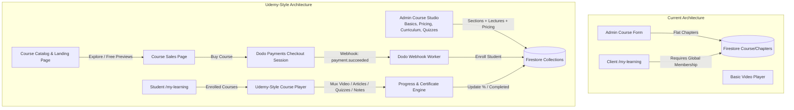
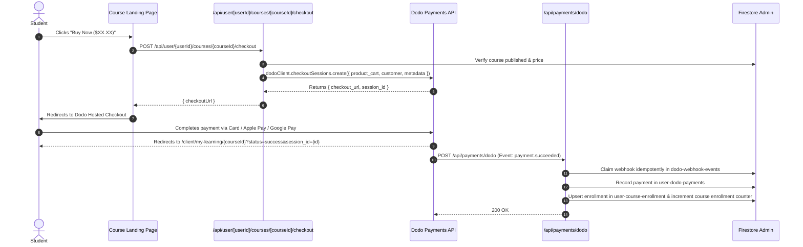

# Udemy-Style Paid Educational Materials Architecture & Implementation Plan

## 1. Executive Summary & Vision

This document details the refactoring of the CEG United educational materials platform into a full-featured, **Udemy-style Learning Management System (LMS)** with **per-course monetization powered by Dodo Payments**.

### Core Objectives

1. **Per-Course Paid Model**: Transition from global membership gatekeeping to an individual paid course model with dynamic pricing, discounts, and one-click Dodo Payments checkout sessions.
2. **Udemy-Grade Curriculum Structure**: Support Sections (modules) containing Lectures with multi-content formats (Mux Video streaming, Rich Text Articles, Downloadable Resources, and Interactive Quizzes).
3. **High-Converting Course Landing Pages**: Rich sales page featuring promo trailer previews, "What You'll Learn" checklists, curriculum breakdown with free preview lectures, instructor credentials, and student reviews.
4. **Distraction-Free Student Learning Player**: Modern theatre mode player with collapsible curriculum accordion, playback speed/quality controls, lesson completion tracking, timestamped notes, Q&A/Discussion, and completion certificates.
5. **Admin Course Studio**: Comprehensive Udemy-style multi-tab course builder (Basics, Target Students, Pricing Setup, Curriculum Builder, Resources, and Publishing Controls).

---

## 2. Current vs. Target Architecture



---

## 3. Data Model & Firestore Schema

### 3.1 Course Collection (`courses/{courseId}`)

```typescript
export interface Course {
  id: string;
  // Basics
  title: string;
  subtitle?: string;
  description: string;
  imageUrl: string;
  promoVideoPlaybackId?: string; // Mux preview trailer
  category: string;
  level: "Beginner" | "Intermediate" | "Advanced" | "All Levels";
  language: string; // e.g. "English"

  // Instructor
  instructor: {
    name: string;
    title: string;
    bio?: string;
    avatarUrl?: string;
  };

  // Target Students / Learning Objectives
  learningObjectives: string[]; // "What you'll learn"
  requirements: string[]; // "Prerequisites"
  targetAudience: string[]; // "Who this course is for"

  // Pricing & Monetization
  isFree: boolean;
  price: number; // In USD / Cents
  discountPrice?: number; // Sale price
  dodoProductId?: string; // Optional explicit Dodo product ID

  // Publishing & Metadata
  isPublished: boolean;
  sectionsCount?: number;
  lecturesCount?: number;
  totalDurationSeconds?: number;
  averageRating?: number;
  totalRatingsCount?: number;
  enrolledStudentsCount?: number;
  createdAt: Date;
  updatedAt: Date;
}
```

### 3.2 Sections Subcollection (`courses/{courseId}/sections/{sectionId}`)

```typescript
export interface CourseSection {
  id: string;
  courseId: string;
  title: string;
  description?: string;
  position: number;
  isPublished: boolean;
  createdAt: Date;
  updatedAt: Date;
}
```

### 3.3 Lectures Subcollection (`courses/{courseId}/sections/{sectionId}/lectures/{lectureId}`)

_(or unified chapter collection with `sectionId` relation for backward compatibility)_

```typescript
export type LectureType = "video" | "article" | "quiz";

export interface Lecture {
  id: string;
  courseId: string;
  sectionId: string;
  title: string;
  description?: string;
  type: LectureType;
  position: number;
  isPublished: boolean;
  isFreePreview: boolean; // Enables free preview before purchase

  // Video Content (Mux)
  videoUrl?: string;
  muxData?: {
    assetId: string;
    playbackId: string;
    durationSeconds?: number;
  };

  // Article Content
  articleContentHtml?: string;

  // Quiz Content
  quiz?: {
    questions: {
      id: string;
      question: string;
      options: string[];
      correctAnswerIndex: number;
      explanation?: string;
    }[];
    passingScorePercentage: number;
  };

  // Lecture Attachments
  attachments?: {
    id: string;
    name: string;
    url: string;
    fileSizeBytes?: number;
  }[];

  durationMinutes?: number;
  createdAt: Date;
  updatedAt: Date;
}
```

### 3.4 Enrollments & User Progress

- `user-course-enrollment`: `{ userId, courseId, dodoPaymentId, enrolledAt, lastAccessedAt, progressPercentage, completedAt, certificateId }`
- `user-course-progress`: `{ userId, courseId, lectureId, isCompleted, quizScore, completedAt }`
- `course-reviews`: `{ courseId, userId, userName, rating, comment, createdAt }`
- `course-notes`: `{ userId, courseId, lectureId, timestampSeconds, content, createdAt }`

---

## 4. Dodo Payments Checkout & Webhook Lifecycle



### Dodo Session Creation Specs

```typescript
export const createCourseCheckoutConfig = async ({
  userId,
  courseId,
  returnUrl,
}: {
  userId: string;
  courseId: string;
  returnUrl?: string;
}) => {
  const course = await getCourseById(courseId);
  if (!course || !course.isPublished)
    throw new Error("Course not available for purchase");

  const finalPrice = course.discountPrice ?? course.price;
  const amountInCents = Math.round(finalPrice * 100);

  const productId =
    course.dodoProductId ||
    process.env.DODO_PRODUCT_COURSE_ID ||
    process.env.DODO_PRODUCT_BUSINESS_SERVICES_ID;

  return createSession({
    userId,
    productId: requireProduct(productId, "Course Purchase"),
    paymentKey: "CoursePurchase",
    amountInCents,
    metadata: {
      courseId,
      courseTitle: course.title,
      type: "COURSE_PURCHASE",
    },
    returnUrl:
      returnUrl ??
      `${process.env.NEXT_PUBLIC_APP_URL}/client/my-learning/${courseId}?purchased=true`,
  });
};
```

---

## 5. Course Player & Student Experience

### 5.1 Course Catalog & Sales Page (`/client/courses/[courseId]`)

- **Hero Header**: Title, Subtitle, Rating stars, Total students enrolled, Instructor, Last updated date.
- **Sticky Purchase Sidebar Card**: Thumbnail with playable trailer preview, Current price + original price + discount badge, "Buy Now" button (triggers Dodo checkout) or "Go to Course" (if already enrolled), 30-Day Money-Back Guarantee badge, Lifetime access feature list.
- **Curriculum Accordion**: Sections & Lectures breakdown with durations, lecture count, and "Preview" buttons for lectures marked `isFreePreview: true`.
- **Learning Objectives**: 2-column checklist of what students will learn.
- **Prerequisites & Target Audience**: Plain, structured requirements list.
- **Instructor Profile Card**: Avatar, bio, ratings, and course counts.
- **Student Reviews & Rating Breakdown**: 5-star distribution chart, written student reviews.

### 5.2 Learning Player (`/client/my-learning/[courseId]`)

- **Theatre Layout**: Clean dark-mode optimized player with sticky sidebar.
- **Main Viewport**:
  - Video Player (Mux): Speed controls (0.75x, 1x, 1.25x, 1.5x, 2x), Skip 10s, auto-play next lecture on video finish.
  - Article Reader: Clean typography with formatted text, images, and embedded resources.
  - Interactive Quiz: Multiple-choice questions, instant feedback, explanations, score summary, retake capability.
- **Right Sidebar (Curriculum Drawer)**:
  - Collapsible Sections with lecture progress icons (`CheckCircle`, `Circle`, `PlayCircle`, `FileText`, `HelpCircle`).
  - Overall progress bar (% and count e.g. "14 / 28 completed").
- **Bottom Workspace Tabs**:
  - **Overview**: Lecture description and instructor notes.
  - **Q&A / Discussion**: Ask questions per lecture, upvote, and view replies.
  - **Personal Notes**: Create timestamped notes that jump directly to video timestamps when clicked.
  - **Downloads / Resources**: One-click download for attached workbooks, PDFs, code files.
  - **Reviews**: Leave star rating and review.

---

## 6. Admin Course Studio & Builder Flow

### 6.1 Multi-Tab Course Builder (`/admin/educational-materials/courses/[courseId]`)

1. **Basics Tab**:
   - Course Title, Subtitle, Category, Level selector, Language selector.
   - Course Thumbnail (Firebase Storage Dropzone).
   - Promo Trailer Video (Mux Uploader with preview playback).
   - Instructor Profile selector/customizer.
2. **Target Students Tab**:
   - Dynamic list items for "What will students learn in this course?".
   - Dynamic list items for "Requirements / Prerequisites".
   - Dynamic list items for "Who is this course for?".
3. **Curriculum Builder Tab**:
   - Add/Edit/Delete Sections (Modules).
   - Drag-and-drop reordering for sections and lectures within sections.
   - Add Lectures with modal selecting content type:
     - **Video Lecture**: Mux Video Upload, Duration, Free Preview toggle.
     - **Article Lecture**: Rich text Quill editor.
     - **Quiz**: Dynamic Question Builder with options and correct answer selector.
   - Lecture-level attachment uploads.
4. **Pricing & Monetization Tab**:
   - "Free vs Paid Course" toggle.
   - Base Price ($ USD) and Discounted Promotional Price ($ USD).
   - Dodo Payments product link/override settings.
5. **Resources Tab**:
   - Course-wide resource uploads and file management.
6. **Publishing & Settings Tab**:
   - Course completion checklist (Basics, Target Students, Curriculum, Pricing).
   - One-click Publish / Unpublish.
   - "Preview as Student" live view.

---

## 7. Implementation Breakdown & Phases

### Phase 1: Schemas & Database Layer

- Update [`schema/educational-materials/course.ts`](schema/educational-materials/course.ts:1) with Udemy data structures (Sections, Lectures, Quizzes, Notes, Reviews, Pricing).
- Update [`schema/payments.ts`](schema/payments.ts:1) to support `CoursePurchase` payment key.

### Phase 2: Dodo Payments Checkout & Webhook Integration

- Add `createCourseCheckoutConfig` to [`service/dodo/index.ts`](service/dodo/index.ts:1).
- Add checkout route at [`app/api/user/[userId]/courses/[courseId]/checkout/route.ts`](app/api/user/[userId]/courses/[courseId]/checkout/route.ts:1).
- Update webhook handler in [`service/dodo/index.ts`](service/dodo/index.ts:450) to fulfill `CoursePurchase` by creating `user-course-enrollment` and incrementing enrolled metrics.

### Phase 3: Service Layer & API Endpoints

- Refactor [`service/educational-materials/course.ts`](service/educational-materials/course.ts:1) and [`service/educational-materials/chapter.ts`](service/educational-materials/chapter.ts:1) to support Sections, Lectures, Quizzes, Notes, and Reviews.
- Create API endpoints for sections, lectures, quiz grading, notes, and course reviews.

### Phase 4: Admin Course Studio Overhaul

- Upgrade [`app/(admin)/admin/educational-materials/courses/[courseId]`](<app/(admin)/admin/educational-materials/courses/[courseId]:1>) with multi-tab Udemy studio layout.
- Build section & lecture manager, quiz builder, and pricing configuration forms.

### Phase 5: Student Experience (Sales Page + Learning Player)

- Build public/student Course Landing & Sales Page with sticky purchase card and Dodo Checkout.
- Overhaul [`app/(client)/client/my-learning/[courseId]/page.tsx`](<app/(client)/client/my-learning/[courseId]/page.tsx:1>) into the Udemy-style theatre learning player with tabs (Overview, Notes, Q&A, Resources, Reviews).
- Implement Quiz runner and completion certificate.

### Phase 6: Testing & Quality Verification

- Unit & integration tests for Dodo checkout session generation, webhook fulfillment, course enrollment permissions, and progress calculations.

---

## 8. Verification & Test Plan

1. **Monetization & Dodo Checkout**:
   - Verify un-enrolled students are directed to the Course Sales Page with accurate price and promo info.
   - Verify clicking "Buy Course" creates a valid Dodo checkout session with course metadata.
   - Verify test webhook triggers enrollment creation and grants instant course access.
2. **Curriculum & Multi-Format Playback**:
   - Test Mux video playback, auto-next on video finish, and speed adjustments.
   - Test Article lecture formatting and completion.
   - Test Quiz taking, scoring, passing criteria, and retake functionality.
3. **Student Learning Features**:
   - Test adding timestamped notes and clicking to seek video position.
   - Test lecture completion toggle and course progress bar updates.
4. **Admin Builder**:
   - Test section creation, lecture reordering, quiz question adding, pricing updates, and publishing workflow.
